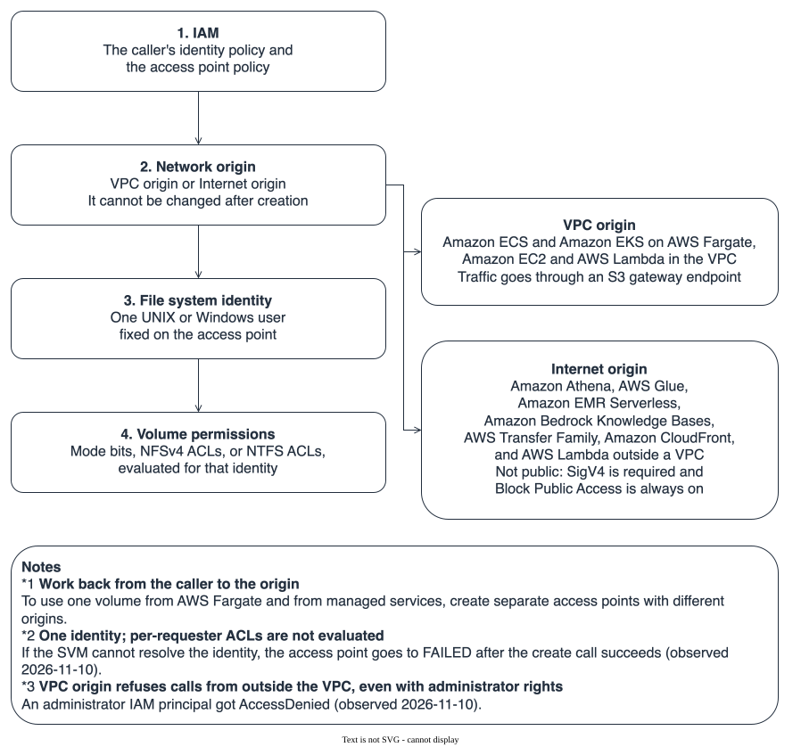

# Use cases and integrations for S3 Access Points for FSx for ONTAP

🌐 **Language / 言語**: [日本語](../ja/s3-access-points-usecase-map.md) | English

This document collects the use cases and integrations of the feature that lets you read and write data you already serve over NFS / SMB through the S3 API as well, without copying it. It covers how on-premises ONTAP users use it, the use cases for new and existing Amazon FSx for NetApp ONTAP (FSx for ONTAP) users, the AWS services and SaaS products it works with, and the prerequisites to check, each with the kind of evidence behind it. The measurements are in section 5.4 of the [storage-verification](atx-containerization-fsxn-storage-verification.md) memo. The research date is 2026-11-11. Regions, versions, limits, and prices change, so reread the source before you rely on one.

---

## 1. Conclusion

**The dividing line of this feature is the origin (the network entry point), and the origin follows where the caller runs.** ECS / EKS on Fargate and EC2 inside a VPC use VPC origin. Managed services such as Amazon Athena and Amazon Bedrock need Internet origin. The origin cannot be changed after creation, so decide it by working back from the callers before you start (Figure 2, section 8).

An AI agent or a first-time reader can check these six points first.

- An access point is an S3 API entry attached to a volume. How the volume behaves over NFS / SMB does not change [Documented].
- Every S3 request is authorized as one UNIX or Windows user fixed on the access point. File ACLs per requester are not evaluated [Documented].
- If the SVM cannot resolve that user, the create call returns success and the access point goes to FAILED afterwards [Tested: this repository, 2026-11-10, one observation].
- ONTAP 9.17.1 or later, the same account, the same Region, and a mounted volume are prerequisites [Documented].
- S3 event notifications, versioning, Object Lock, and lifecycle are not available [Documented]. S3 reads and writes share the file system's throughput with NFS / SMB [Documented].
- The integration status is in the tables of section 7. Where no public statement was found, the table says "no public statement found", not "unsupported".

| What you want to know | Section |
|---|---|
| The overall picture and the container check on real infrastructure | 9, Figure 1 |
| Which services can use it | 7, Figure 3 |
| How to choose the origin and authorization | 8, Figure 2 |
| How it differs from on-premises ONTAP | 4 |
| Use cases for new users and for existing users | 5 and 6 |
| What to check before attaching | 6.2 |
| The list of constraints | 10 |

---

## 2. Terms used in this document

| Term | Meaning |
|---|---|
| Access point | S3 Access Points. The S3 API entry you attach to an FSx for ONTAP volume. It has a name and can carry an IAM policy |
| alias | The name you pass as `--bucket` for an access point (it ends in `-ext-s3alias`). An ARN also works, and some services accept only one of the two |
| origin | The network range the access point accepts calls from. VPC origin accepts the VPC you name; Internet origin also accepts callers outside the VPC. Both require SigV4 |
| File system identity | The UNIX or Windows user fixed on the access point. Every S3 request operates on files with this user's permissions |
| NAS bucket | The on-premises ONTAP S3 mechanism that presents a NAS volume's directories as a bucket (ONTAP 9.12.1 and later) |
| Hub / other repository | The Hub is [FSx-for-ONTAP-Adoption-Playbook](https://github.com/Yoshiki0705/FSx-for-ONTAP-Adoption-Playbook), which holds decision guidance for FSx for ONTAP. Other repositories are the same author's separate repositories that hold real-infrastructure checks (serverless, data lake, S3 Burst, and others). Each linked file has its environment and date |

---

## 3. Evidence tiers

| Tag | Meaning |
|---|---|
| **[Documented]** | A statement in a user guide or reference from AWS, NetApp, or the service. Source URL given |
| **[Published]** | An announcement, blog post, or case published by AWS or NetApp. Marketing context; effect figures are not reproduced |
| **[Tested: this repository]** | A result checked on real infrastructure in this repository (environment and scope in 5.4) |
| **[Tested: other repository]** | A result from another repository by the same author; the linked file has the environment and date |
| **[No public statement found]** | Not found in what was searched. It does not mean unsupported |
| **[Hypothesis]** | An inference from public information, not checked |
| **[Not measured]** | Not run. No result exists in this repository or in the other repositories |

---

## 4. How on-premises ONTAP uses it, and how it maps to the AWS side

The feature originates in on-premises ONTAP. 4.1 lists the use cases first, and 4.2 sets out how the AWS side differs.

### 4.1 On-premises use cases

On-premises ONTAP has "NAS buckets" that present a NAS volume as an S3 bucket (ONTAP 9.12.1 and later). The use cases NetApp's documentation names are analytics, BI, and ML tools reading data that NAS clients created, and applications that read and write the same data over both NAS and S3 [Documented] ([NAS bucket overview](https://docs.netapp.com/us-en/ontap/s3-multiprotocol/index.html), [S3 use cases](https://docs.netapp.com/us-en/ontap/s3-config/use-cases.html)).

| Use case | Basis |
|---|---|
| Analytics, BI, ML, and OCR tools read data NAS clients wrote, over S3 | [Documented] ([NetApp](https://docs.netapp.com/us-en/ontap/s3-config/use-cases.html)) |
| Spark and Kafka-style apps read and write the same files over NAS and S3 | [Documented] ([NetApp](https://docs.netapp.com/us-en/ontap/s3-multiprotocol/index.html)) |
| Read a NAS volume as S3 instead of building an ingestion copy for a data lake | [Published] ([NetApp blog](https://www.netapp.com/blog/data-landing-zones-ontap-s3-nas-volumes/), 2025-05; the effects it states are not backed by a measurement) |
| Prepare training data on NAS, move it to an ONTAP S3 endpoint, and train from there | [Published] ([NetApp reference pipeline](https://docs.netapp.com/us-en/netapp-solutions-ai/infra/ai-pipeline-solution-overview.html); a design example, not a user's deployment) |
| Read a FlexCache cache volume over S3 at a remote site (9.18.1 and later, both clusters) | [Documented] ([FlexCache FAQ](https://docs.netapp.com/us-en/ontap/flexcache/flexcache-duality-faq.html)) |
| Protect the volume behind a NAS bucket with asynchronous volume SnapMirror | [Documented] ([NetApp](https://docs.netapp.com/us-en/ontap/s3-multiprotocol/index.html)) |
| Replicate on-premises ONTAP to FSx for ONTAP with SnapMirror, then hand the data to AWS AI and analytics services through an access point | [Published] ([NetApp blog](https://www.netapp.com/blog/data-access-s3-access-points-fsx-ontap/), [announcement](https://www.netapp.com/newsroom/press-releases/news-rel-20251202-161273/), 2025-12-02) |

**No public case that names an organization was found.** In what was searched, there was no public page naming an organization that runs NAS buckets in production, no third-party evaluation, and no throughput or latency figures for NAS buckets.

### 4.2 Differences from the AWS-side access point

| Aspect | On-premises NAS bucket | FSx for ONTAP access point |
|---|---|---|
| Entry point | The S3 server on an SVM. You provide LIFs, an FQDN, and certificates | An AWS-managed S3 endpoint, called by alias |
| Unit of authorization | ONTAP S3 users are mapped to NAS users; each S3 user is judged with that NAS user's permissions | IAM plus the access point policy; on the file side, one fixed identity |
| Policy | ONTAP bucket policy (a limited set of actions) | IAM and the access point policy |
| Unsupported features | Versioning, Object Lock, lifecycle | The same, plus ACLs (other than `bucket-owner-full-control`) and conditional writes |
| Checksums | Stored and returned from 9.20.1 | Validated at upload, not stored, not returned |
| Protection | Asynchronous volume SnapMirror; synchronous and SVM-DR are not supported | FSx features (backups, SnapMirror); in-progress multipart parts are excluded |

**The per-requester permission check does not carry over to the AWS side.** A design that relied on each S3 user being judged with a NAS user's permissions on premises needs to be rebuilt by splitting access points per requester or per permission set. Neither AWS nor NetApp documents whether the AWS-side mechanism sits on the same implementation as NAS buckets. This document states only the matching list of unsupported features as fact, and keeps the implementation link a hypothesis [Hypothesis].

---

## 5. Use cases for new FSx for ONTAP users

New users are people creating a file system now, and people creating one as a landing zone for a migration. AWS's announcement said new file systems are supported first [Published] ([What's New, 2025-12-02](https://aws.amazon.com/about-aws/whats-new/2025/12/amazon-fsx-netapp-ontap-s3-access/)). **No official guide that treats new and existing users separately was found. This split is a rearrangement of public information.**

| Use case | Starting point | What S3 access does | What to decide first | Basis |
|---|---|---|---|---|
| Use migrated document shares for RAG or BI chat | NAS shares full of PDFs and Office files | Amazon Bedrock Knowledge Bases or Amazon Quick reads the volume by alias | Internet origin; match the identity type to the volume's security style; a vector store | [Documented] ([Bedrock tutorial](https://docs.aws.amazon.com/fsx/latest/ONTAPGuide/tutorial-build-rag-with-bedrock.html)), [Published] ([AWS News Blog](https://aws.amazon.com/blogs/aws/amazon-fsx-for-netapp-ontap-now-integrates-with-amazon-s3-for-seamless-data-access/)) |
| Handle files that existing systems write with SQL and ETL | Legacy systems that export CSV or Parquet to a share | Amazon Athena, AWS Glue, and Amazon EMR Serverless read | Internet origin; the Glue Data Catalog | [Documented] ([Athena tutorial](https://docs.aws.amazon.com/fsx/latest/ONTAPGuide/tutorial-query-data-with-athena.html)) |
| Automatic file processing (thumbnails, text extraction, transcription) | Content placed on a share | AWS Lambda reads and writes | Run Lambda outside a VPC, or use VPC origin and put it in the VPC | [Documented] ([Lambda tutorial](https://docs.aws.amazon.com/fsx/latest/ONTAPGuide/tutorial-process-files-with-lambda.html)) |
| SFTP / FTPS / FTP for outside parties | SMB / NFS inside, SFTP for the other side | AWS Transfer Family reads and writes the volume by alias | Internet origin; alias only; create home directories through the S3 API | [Documented] ([Transfer Family](https://docs.aws.amazon.com/transfer/latest/userguide/fsx-s3-access-points.html)), [Published] ([AWS Storage Blog](https://aws.amazon.com/blogs/storage/secure-sftp-file-sharing-with-aws-transfer-family-amazon-fsx-for-netapp-ontap-and-s3-access-points/), 2026-03) |
| Build the destination file system expecting S3 consumers to be added later | A migration from an on-premises NAS | The same file system serves NFS / SMB to migrated apps and the S3 API to new consumers | Security style per volume; AD join; size throughput for NAS and S3 together; headroom in the volume count | [Published] ([What's New](https://aws.amazon.com/about-aws/whats-new/2025/12/amazon-fsx-netapp-ontap-s3-access/)), [Documented] ([AWS](https://docs.aws.amazon.com/fsx/latest/ONTAPGuide/s3-ap-manage-access-fsxn.html)) |
| Containers read shared reference data | ECS / EKS (EC2 and Fargate) | Call the alias with the S3 SDK; there is no mount | Task role or IRSA; VPC origin and a gateway endpoint | [Documented] ([ECS storage options](https://docs.aws.amazon.com/AmazonECS/latest/developerguide/using_data_volumes.html), ECS only), [Published] (AWS News Blog), [Tested: this repository] (5.4 of storage-verification) |

**Three things a new user decides first.** (1) The security style of each volume and the identity type (UNIX or Windows), (2) the origin for each caller, (3) the number of volumes. Using access points lowers the maximum number of volumes per file system: from 500 to 491 for first generation and for second generation with one HA pair, from 1,000 to 975 for second generation with two HA pairs, and to 903 at 12 pairs [Documented] ([quotas](https://docs.aws.amazon.com/fsx/latest/ONTAPGuide/limits.html), checked 2026-11-11).

---

## 6. Use cases for existing FSx for ONTAP users, and what to check before attaching

6.1 covers use cases when you attach an access point to a file system that is already running; 6.2 lists what to check before you do.

### 6.1 Use cases

AWS's documentation says that attaching an access point does not change how the volume behaves over NFS / SMB [Documented] ([managing access](https://docs.aws.amazon.com/fsx/latest/ONTAPGuide/s3-ap-manage-access-fsxn.html)).

| Use case | Starting point | Basis |
|---|---|---|
| Add AI and analytics to shares already in use, without a second copy | Departmental shares used over SMB / NFS | [Documented], [Published] |
| On an AD-joined SVM, split access points per user or team and hand them to BI and AI tools | Shares whose permissions are managed with NTFS ACLs | [Published] ([AWS Storage Blog](https://aws.amazon.com/blogs/storage/enabling-ai-powered-analytics-on-enterprise-file-data-configuring-s3-access-points-for-amazon-fsx-for-netapp-ontap-with-active-directory/), 2026-04) |
| Add SFTP for outside parties to existing NFS / SMB workflows | Apps that already put files in and take them out | [Documented], [Published] (AWS Storage Blog, 2026-03) |
| Scheduled sync pipelines (knowledge base sync, crawlers, batch ETL) | Files a legacy app writes at fixed times | [Documented]. S3 event notifications are unavailable, so the reader runs on a schedule |
| Run Lambda or containers beside the legacy app | Stepwise modernization | [Documented] (Lambda), [Tested: this repository] (ECS / EKS on Fargate) |

For analyzing from a SnapMirror destination volume, AWS says a data protection volume can take an access point if it has a junction path [Documented]. How the access point behaves after a SnapMirror break or a restore has no public statement and was not tried in any of the repositories [Not measured].

### 6.2 Checks before attaching

| # | What to check | Basis |
|---|---|---|
| 1 | Is ONTAP 9.17.1 or later (read it with the ONTAP REST API `GET /api/cluster?fields=version` or the CLI `version` command)? The only statement found on how an existing file system gets there is the "upcoming weekly maintenance window" sentence in the 2025-12-02 announcement | [Documented] ([restrictions](https://docs.aws.amazon.com/fsx/latest/ONTAPGuide/access-point-for-fsxn-restrictions-limitations-naming-rules.html)), [Published] |
| 2 | Is the volume mounted (junction path)? If it goes offline or is unmounted, the access point goes to MISCONFIGURED | [Documented] |
| 3 | Is the S3 protocol allowed on the SVM? | [Documented] |
| 4 | Can ONTAP resolve the identity? Check the name service settings (local, LDAP) for UNIX and the joined AD for Windows. If it cannot, the access point goes to FAILED or MISCONFIGURED | [Documented], [Tested: this repository] (FAILED with `ec2-user`; only UNIX identities were tried in this repository) |
| 4a | If the SVM is joined to AD, can it reach a domain controller? If not, ListObjectsV2, GetObject, and PutObject return AccessDenied while HeadBucket succeeds, so HeadBucket is not a health check | [Tested: other repository] ([AD-joined SVM prerequisites](https://github.com/Yoshiki0705/FSx-for-ONTAP-S3AccessPoints-Serverless-Patterns/blob/main/docs/en/ad-joined-svm-s3ap-prerequisites.md)) |
| 5 | Does the identity type match the volume's security style (UNIX for UNIX style, Windows for NTFS)? | [Documented] |
| 6 | How existing share and export controls apply. AWS's blog says SMB share permissions do not apply to the S3 path and only file and folder NTFS ACLs do (this repository did not try a Windows identity). No public statement was found on how NFS export policies relate | [Published] |
| 7 | Throughput headroom. S3 requests use the file system's throughput, and exceeding it returns errors such as `503 Slow Down` | [Documented] ([troubleshooting](https://docs.aws.amazon.com/fsx/latest/ONTAPGuide/troubleshooting-access-points-for-fsxn.html)) |
| 8 | Does the volume count stay within the limit? 491 for first generation and for second generation with one HA pair, 975 with two HA pairs, 903 with 12 pairs | [Documented] (quotas) |
| 9 | The origin for each caller. The origin cannot be changed after creation | [Documented] ([network](https://docs.aws.amazon.com/fsx/latest/ONTAPGuide/configuring-network-access-for-s3-access-points.html)) |
| 10 | Same account and same Region? | [Documented] |
| 11 | Does the design assume S3 event notifications, versioning, Object Lock, or lifecycle? | [Documented] ([compatibility](https://docs.aws.amazon.com/fsx/latest/ONTAPGuide/access-points-for-fsxn-object-api-support.html)) |
| 12 | A directory created over NFS / SMB disappears from the S3 side once it is empty. Create directories the S3 side depends on through the S3 API | [Published] (AWS Storage Blog) |

### 6.3 States and first actions

| State | Main cause | First action | Basis |
|---|---|---|---|
| FAILED (right after creation) | The SVM cannot resolve the identity | Delete the access point and recreate it with a resolvable identity. The identity cannot be changed after creation | [Tested: this repository] (FAILED after about 45 seconds) |
| MISCONFIGURED | The identity stopped resolving, or the volume went offline or was unmounted | Fix the name service or the volume. It returns to AVAILABLE once the cause is resolved | [Documented] ([creating access points](https://docs.aws.amazon.com/fsx/latest/ONTAPGuide/create-access-points.html)) |
| AccessDenied (from outside the VPC) | A VPC-origin access point | Create a separate access point with the origin the caller needs | [Tested: this repository] |
| AccessDenied (AD-joined SVM) | No domain controller is reachable | Check the route and DNS to the DC | [Tested: other repository] |
| `503 Slow Down` and similar | Not enough throughput | Watch throughput utilization in CloudWatch and raise the throughput capacity | [Documented] ([troubleshooting](https://docs.aws.amazon.com/fsx/latest/ONTAPGuide/troubleshooting-access-points-for-fsxn.html)) |

For monitoring, poll the Lifecycle state, and write and read back a small object with a sha256 comparison. HeadBucket alone misses problems on an AD-joined SVM.

---

## 7. Map of integrations

Figure 3: Consumers grouped by the origin they need. The figure shows services whose origin is known from AWS documentation or a measurement. Their constraints (Athena is read-only, EMR cannot write Iceberg, and so on) and the services not drawn are in the tables of 7.1 to 7.5.

**How to read the tables.** "Basis" uses the tags of section 3. When a row has several tags, each has its own source.

### 7.1 AWS compute and containers

| Consumer | Origin | How it is used | Basis | Notes |
|---|---|---|---|---|
| Amazon ECS (AWS Fargate) | VPC | Call the alias or ARN with the S3 SDK; task role | [Documented] ([ECS storage options](https://docs.aws.amazon.com/AmazonECS/latest/developerguide/using_data_volumes.html): FSx for ONTAP is a native mount on EC2 and through S3 Access Points on Fargate), [Tested: this repository] | There is no mount. A gateway endpoint does not carry on-premises or peered traffic |
| Amazon EKS (AWS Fargate) | VPC | IRSA; CoreDNS on Fargate | [Tested: this repository] | No AWS public page naming EKS for this was found |
| Amazon EKS (EC2) | VPC | Call the S3 SDK with node or Pod IAM | [No public statement found] | The container-storage check for EKS on EC2 covers Trident PVs, a different path |
| AWS Lambda | Internet outside a VPC, VPC inside | S3 SDK; automatic file processing | [Documented], [Tested: other repository] ([networking check](https://github.com/Yoshiki0705/fsxn-lakehouse-integrations/blob/main/docs/en/fsx-ontap-s3ap-networking.md)) | A Lambda in a VPC calling an Internet-origin access point through a gateway endpoint timed out. NAT, or a Lambda outside the VPC, worked |
| Amazon EC2 | Either | AWS CLI or SDK | [Documented] | Can be used alongside an NFS / SMB mount |
| AWS Batch | n/a | n/a | [No public statement found] | Batch jobs are container workloads, so with the S3 SDK it is presumably the same as ECS [Hypothesis] |

### 7.2 AWS data, analytics, and AI

| Consumer | Origin | How it is used | Basis | Notes |
|---|---|---|---|---|
| Amazon Athena | Internet | An alias in the LOCATION of a Glue catalog table | [Documented] ([tutorial](https://docs.aws.amazon.com/fsx/latest/ONTAPGuide/tutorial-query-data-with-athena.html)), [Tested: other repository] ([compatibility matrix](https://github.com/Yoshiki0705/fsxn-lakehouse-integrations/blob/main/docs/en/compatibility-matrix.md)) | Read-only. Parquet / CSV / JSON / ORC reads and Iceberg reads and writes were checked (2026-08-06, small scale) |
| AWS Glue | Internet | Crawlers and ETL | [Documented], [Tested: other repository] (matrix) | Parquet append was checked. Overwrite is delete plus write, not atomic |
| Amazon EMR Serverless | Internet | Read and write with Spark | [Documented], [Tested: other repository] (matrix) | Parquet reads and appends were checked. Iceberg writes are unsupported because conditional writes are missing |
| Amazon Redshift Spectrum | Internet (from the Athena statement) | External schema | [Tested: other repository] (matrix, 2026-05-23) | AWS's documentation says only that the Athena catalog table can be reused |
| Amazon Bedrock Knowledge Bases | Internet | The alias as the data source | [Documented] ([tutorial](https://docs.aws.amazon.com/fsx/latest/ONTAPGuide/tutorial-build-rag-with-bedrock.html)), [Tested: other repository] (matrix) | Files over 50 MB are skipped. ACLs are not carried into the index |
| Amazon Quick | Not stated | The alias in an S3 integration | [Published] (AWS Storage Blog, 2026-04) | The sync fails if the identity cannot read the data. No [Tested: other repository] result ([Hub summary](https://github.com/Yoshiki0705/FSx-for-ONTAP-Adoption-Playbook/blob/main/docs/ja/ai-agents/quick/README.md), Japanese) |
| Amazon Textract / Amazon Transcribe | Via Lambda | Lambda reads and passes to the API; Transcribe accepts the alias directly | [Documented] (Lambda tutorial) | The synchronous Textract API handles up to 10 MB and one page |
| Amazon SageMaker | n/a | The announcement text says it can be used for training | [Published] (sentence level only) | No step-by-step page was found |

### 7.3 Transfer and delivery

| Consumer | Origin | How it is used | Basis | Notes |
|---|---|---|---|---|
| AWS Transfer Family | Internet | Alias only (ARN not accepted); SFTP / FTPS / FTP | [Documented] ([Transfer Family](https://docs.aws.amazon.com/transfer/latest/userguide/fsx-s3-access-points.html)), [Published] | No rename or append. Create home directories through the S3 API |
| Amazon CloudFront | Internet | As an origin, with OAC and SigV4 | [Documented] ([tutorial](https://docs.aws.amazon.com/fsx/latest/ONTAPGuide/using-access-points-with-aws-services.html)) | Check the signing behavior of each CDN in your own environment |

### 7.4 SaaS and ISV products

| Consumer | Basis | Notes |
|---|---|---|
| Snowflake | [Tested: other repository] (matrix, 2026-08-06) | Specify `AWS_ACCESS_POINT_ARN` on the stage. Without it, `LIST` worked and `SELECT` was denied. Snowpipe auto-ingest is unavailable because there are no notifications |
| Databricks | [Tested: other repository] (matrix, 2026-08-12) | A Unity Catalog external location registers, but reads were denied. No public vendor statement was found |
| Dremio | [Published] ([Dremio blog](https://subsurface2.dremio.com/blog/from-file-systems-to-ai-insights-dremio-cloud-amazon-fsx-for-netapp-ontap/), 2026-09) | No limits or measurements stated |
| Nextcloud | [Tested: other repository] ([test harness](https://github.com/Yoshiki0705/FSx-for-ONTAP-S3AccessPoints-Serverless-Patterns/blob/main/solutions/nextcloud-test/README.md)) | No public page from the vendor was found |
| Splunk, Elastic, backup products, and others | [No public statement found] | In what was searched, nothing described them as readers of an access point |

NetApp published a statement that the data connects to more than 50 AWS services and to Snowflake and Databricks [Published]. The Databricks part differs from the measurement above. This document does not pick a side and lists both.

### 7.5 What no public statement was found for

These are not "unsupported". In what was searched, no public statement exists: AWS DataSync (its S3 location page mentions access points only for S3 on Outposts), AWS Backup, Amazon Macie and Amazon GuardDuty Malware Protection for S3 (both documents assume general purpose buckets), AWS Storage Gateway, Amazon OpenSearch Service (only as a Bedrock vector store), Amazon Comprehend, and Amazon Rekognition.

---

## 8. Choosing the origin and authorization

Figure 2: The four gates a request passes, and how the origin splits the callers.

**There are four gates, a request must pass all of them, and the last two sit outside AWS IAM.** They are IAM and the access point policy (1), the origin (2), the identity fixed on the access point (3), and the volume's mode bits or ACLs (4). The numbering in the figure is a reading order, not an AWS statement of evaluation order. The evaluation order, with sources, is in the Hub's [decision tree](https://github.com/Yoshiki0705/FSx-for-ONTAP-Adoption-Playbook/blob/main/docs/ja/reference/decision-trees/access-point-authorization.md) (Japanese). Within one account, either the identity policy or the access point policy granting access is enough, so restricting needs an explicit Deny [Documented].

| Caller | Origin | What to pass as `--bucket` | Authentication | Basis |
|---|---|---|---|---|
| Amazon ECS (AWS Fargate) | VPC | Alias or ARN | Task role | [Tested: this repository] |
| Amazon EKS (AWS Fargate) | VPC | Alias or ARN | IRSA (EKS Pod Identity cannot be used on Fargate) | [Tested: this repository] |
| Amazon EC2 / AWS Lambda in a VPC | VPC (through an S3 gateway endpoint) | Alias or ARN | Instance role / execution role | [Documented] |
| AWS Lambda outside a VPC | Internet | Alias or ARN | Execution role | [Documented], [Tested: other repository] |
| Amazon Athena / AWS Glue / Amazon EMR Serverless | Internet | Alias in the Glue catalog | Each service's role | [Documented], [Tested: other repository] |
| Amazon Bedrock Knowledge Bases | Internet | Alias as the data source | Service role (policy on the access point ARN) | [Documented] |
| AWS Transfer Family | Internet | Alias only | IAM role per user | [Documented] |
| Snowflake | Internet in the other repository's measurement | Alias and `AWS_ACCESS_POINT_ARN` on the stage | IAM role of the storage integration | [Tested: other repository] |

- **Make the policy `Resource` the access point ARN.** S3 Control rejected `Resource: '*'` [Tested: this repository, 2026-11-10].
- **VPC origin refuses requests from outside the VPC.** An administrator IAM principal also got AccessDenied [Tested: this repository, 2026-11-10]. Internet origin is not public either: SigV4 is required and Block Public Access is always on [Documented].
- **To use one volume from Fargate and from managed services, create access points with different origins.** AWS's blog also recommends separate access points for parties with different requirements [Published].
- **Use a dedicated non-root identity.** With a local SVM user, reads and writes were narrowed by the mode bits [Tested: this repository, 5.4]. `root` authorizes every file, so keep it to a measurement condition.
- **On an AD-joined SVM, when DNS or a domain controller was unreachable, access point calls failed even for UNIX-style volumes.** The actions are in 4a of 6.2 and in 6.3 [Tested: other repository] ([networking check](https://github.com/Yoshiki0705/fsxn-lakehouse-integrations/blob/main/docs/en/fsx-ontap-s3ap-networking.md)).

The evaluation order in detail is in the Hub's [layers of access point authorization](https://github.com/Yoshiki0705/FSx-for-ONTAP-Adoption-Playbook/blob/main/docs/en/domains/security-governance/notes/access-point-authorization-layers.md).

---

## 9. The container check, and combining it with isolated pods

Figure 1: The path from containers to the volume.

On 2026-11-10 in ap-northeast-1, against a disposable SVM and volume, reads, writes, and listing worked from ECS and EKS (1.35) on Fargate [Tested: this repository]. Both the alias and the ARN worked, and the sha256 before and after writing matched. The full results, including visibility from the NFS side, FAILED with `ec2-user`, permissions with a non-root user, and the match with the baseline after teardown, are in [section 5.4 of storage-verification](atx-containerization-fsxn-storage-verification.md). The two defects found (the policy `Resource` and the identity default) are fixed in the templates.

Figure 4: The storage an isolated pod could mount, and the storage it could not

**In an isolated EKS pod (Nitro Sandbox), a Trident NFS PV could not be used.** Container creation failed, while an EBS PVC worked (one observation). Reading the data through an access point with the S3 SDK is one possible option for using FSx for ONTAP data from an isolated pod. This document did not check calling an access point from an isolated pod [Not measured]. The details of the observation are in [section 9.1 of storage-verification](atx-containerization-fsxn-storage-verification.md). The gap in how third-party CSI drivers are covered was filed as [documentation feedback](https://github.com/awsdocs/amazon-eks-user-guide/issues/1259), and NFS and block support as feature requests ([NFS](https://github.com/aws/containers-roadmap/issues/2911), [block](https://github.com/aws/containers-roadmap/issues/2912)). Filing an issue does not mean AWS accepted or prioritized it.

---

## 10. Constraints and prerequisites

| Item | Content | Source |
|---|---|---|
| ONTAP | 9.17.1 or later | [Documented] |
| Account and Region | Same as the volume | [Documented] |
| Volume | Mounted; the S3 protocol allowed on the SVM | [Documented] |
| Unsupported S3 features | ACLs other than `bucket-owner-full-control`, Object Annotations, Requester Pays, versioning, Object Lock, lifecycle, static website hosting, MFA Delete, conditional writes, getting the bucket notification configuration | [Documented] ([compatibility](https://docs.aws.amazon.com/fsx/latest/ONTAPGuide/access-points-for-fsxn-object-api-support.html)) |
| Storage class and encryption | `FSX_ONTAP` only; SSE-FSX only | [Documented] |
| Maximum upload size | A single PutObject and a single part are capped at 5 GiB (5,368,709,120 bytes); a whole object reaches 50 GiB through multipart. The whole-object limit is only checked at CompleteMultipartUpload, so an over-limit upload is rejected after the full transfer. Check the size on the client before uploading. Measured on first-generation Single-AZ, 128 MBps, identity `root`, Internet origin | [Documented] (50 GiB), [Tested: other repository] ([object size check](https://github.com/Yoshiki0705/FSx-for-ONTAP-S3AccessPoints-Serverless-Patterns/blob/main/docs/s3ap-object-size-limits-verification.en.md), 2026-08-02) |
| Copy | Within the same access point only [Documented]. UploadPartCopy is documented as supported but failed with `NoSuchKey` | [Documented], [Tested: other repository] (same) |
| Checksums | Validated, not stored, not returned. The ETag is not an MD5 | [Documented] |
| In-progress multipart | Not in volume backups. The space shows in the file system's `StorageUsed`, not the volume's | [Documented] |
| Throughput | Depends on the file system's provisioned throughput. Latency is "tens of milliseconds" [Documented]. On a first-generation Single-AZ file system at 128 MBps with Internet origin, the P50 for a 1 MB GetObject at concurrency 10 was 73 ms from a Lambda outside a VPC and 175 ms from a local client; P99 exceeded 1 second at concurrency 25 and above. The VPC-origin path was not measured in that benchmark. A sizing reference, not a service limit | [Documented], [Tested: other repository] ([benchmark](https://github.com/Yoshiki0705/FSx-for-ONTAP-S3AccessPoints-Serverless-Patterns/blob/main/docs/s3ap-benchmark-results.en.md), 2026-05) |
| Price | S3 request and data transfer charges through the access point apply on top of FSx charges. Check unit prices, with the Region and date, on the [FSx for ONTAP pricing page](https://aws.amazon.com/fsx/netapp-ontap/pricing/) and the S3 pricing page. A Lambda in a VPC using Internet origin adds NAT charges | [Documented], [Published] |
| Volume count limit | 500 → 491 for first generation and second generation with one HA pair, 1,000 → 975 with two HA pairs, 903 with 12 pairs | [Documented] |
| What cannot be changed | The origin and the file system identity | [Documented], [Tested: this repository] (the identity cannot be changed after creation) |
| Event notifications | Unavailable (as of 2026-11-11). FPolicy did not detect writes through an access point either (0 of 9 calls, 2026-08-26) | [Documented], [Tested: other repository] ([evidence](https://github.com/Yoshiki0705/FSx-for-ONTAP-S3AccessPoints-Serverless-Patterns/blob/main/docs/aws-feature-requests/native-s3ap-notifications-evidence.en.md)) |
| Concurrent NFS and S3 writes | No statement was found in AWS's pages. Another repository has a [write conflict check](https://github.com/Yoshiki0705/FSx-for-ONTAP-S3AccessPoints-Serverless-Patterns/blob/main/docs/en/nfs-s3ap-write-conflict.md) | [No public statement found], [Tested: other repository] |

---

## 11. Statements that disagree and are not resolved

These three points are places where AWS's own statements, or a statement and a measurement, disagree. This document lists them without choosing. Reread the source before you use one.

- **Transfer Family upload limit.** The AWS Storage Blog (the SFTP post) says 5 GB per file. In another repository's measurement, 5 GiB is the single-PutObject limit and a whole object reached 50 GiB through multipart. Whether Transfer Family uses multipart was not checked, so this document does not decide whether the blog's 5 GB holds on the Transfer Family path.
- **Regions.** The 2026-11-06 row of the FSx document history mentions "the China Regions", which the Region table read on the same day does not list.
- **Event notifications.** The reference lists `GetBucketNotificationConfiguration` as unsupported, and an AWS blog has a sentence about triggering from S3 events. The blog's worked architectures use EventBridge schedules and scheduled Step Functions runs, and this document followed the reference.

---

## 12. Steps to check in your own environment

1. List the callers and decide the origin with section 7. If managed services and in-VPC compute both appear, create separate access points.
2. Decide the identity. Match the volume's security style, and confirm on the ONTAP side that the SVM can resolve it. Avoid `root`.
3. Check the ONTAP version, the S3 protocol, the volume mount, and the volume count headroom with 6.2.
4. On a disposable volume, run once through create → write → read back with a sha256 comparison → list → teardown. The templates are `templates/containers-ecs-fargate-fsxn-s3ap.yaml` and `templates/containers-eks-fargate-fsxn-s3ap.yaml`, and `FileSystemUnixUser` is required. The procedure and expected results are in [section 5.4 of storage-verification](atx-containerization-fsxn-storage-verification.md).
5. If NFS / SMB clients exist, measure in your own environment when an S3 write becomes visible over NFS. This repository's observation is only that it was visible at about 28 seconds and at about 100 seconds.
6. Replace any design that assumes S3 event notifications with scheduled polling.

This document is material for a technical evaluation and does not replace a security or compliance assessment. This repository's measurements used disposable environments and synthetic data.

---

## Reference links

- [Accessing your data via Amazon S3 access points](https://docs.aws.amazon.com/fsx/latest/ONTAPGuide/accessing-data-via-s3-access-points.html)
- [Access point compatibility](https://docs.aws.amazon.com/fsx/latest/ONTAPGuide/access-points-for-fsxn-object-api-support.html)
- [Managing access point access](https://docs.aws.amazon.com/fsx/latest/ONTAPGuide/s3-ap-manage-access-fsxn.html)
- [Using access points with AWS services](https://docs.aws.amazon.com/fsx/latest/ONTAPGuide/using-access-points-with-aws-services.html)
- [Amazon FSx for NetApp ONTAP now supports Amazon S3 access (What's New, 2025-12-02)](https://aws.amazon.com/about-aws/whats-new/2025/12/amazon-fsx-netapp-ontap-s3-access/)
- [Amazon S3 Access Points for Amazon FSx are now available in additional AWS Regions (What's New, 2026-11)](https://aws.amazon.com/about-aws/whats-new/2026/11/s3-access-points-fsx-regions/)
- [NetApp: S3 NAS buckets (multiprotocol)](https://docs.netapp.com/us-en/ontap/s3-multiprotocol/index.html)
- [storage-verification (this repository)](atx-containerization-fsxn-storage-verification.md)
