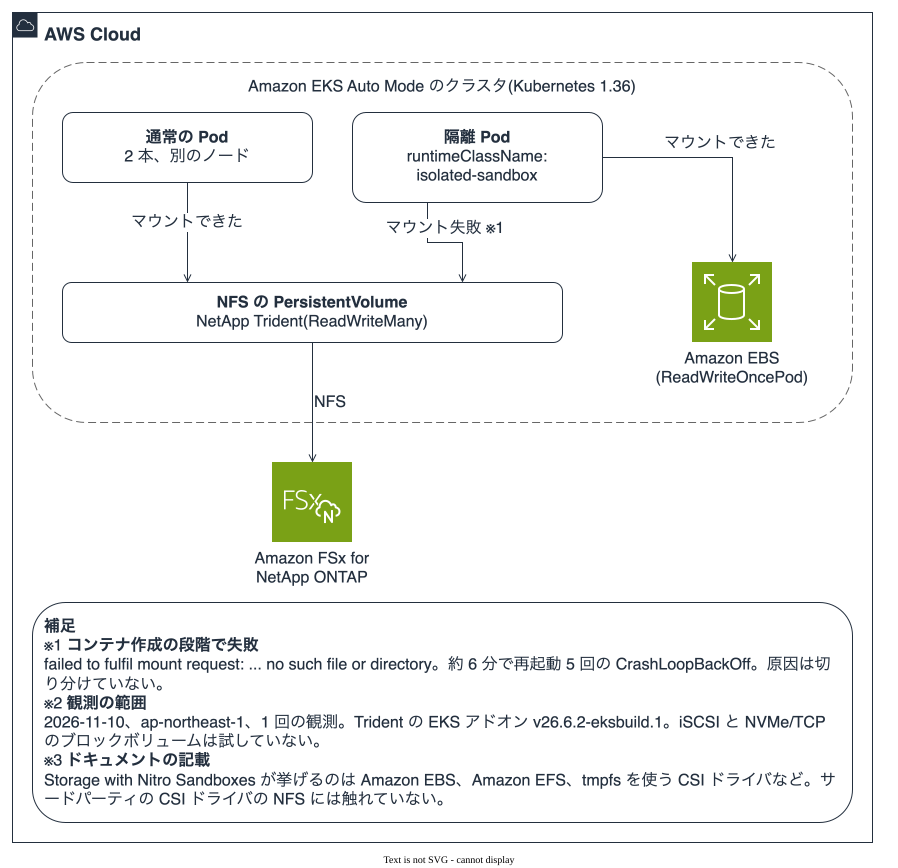
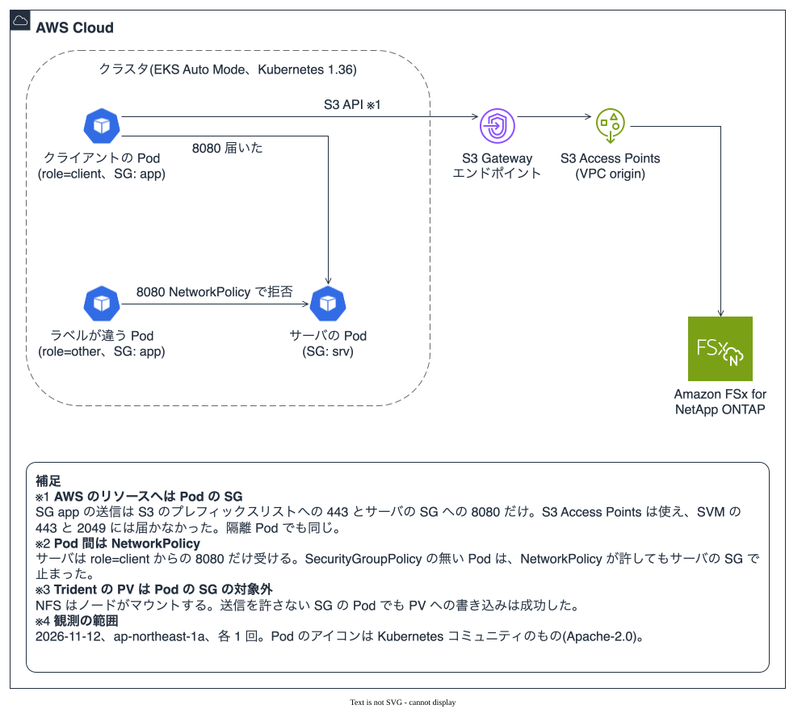

# コンテナ移行先での FSx for ONTAP データストア構成の検証

**目的**: AWS Transform でコンテナ化した後の実行環境(ECS on EC2 / EKS on EC2 / ECS on Fargate / EKS on Fargate)で、Amazon FSx for NetApp ONTAP をデータ領域として使う 4 構成の実現性を一次情報で確定し、実現するものは CloudFormation テンプレート化して静的検証まで行う。

**最終更新**: 2026-11-12
**ステータス**: 文献調査 + CloudFormation 作成 + 静的検証(cfn-lint)+ 4 構成の実機デプロイ(小規模、3.3、4.3、5.4)+ コンテナからの S3 Access Points の性能と可視化(5.5、5.6)+ Nitro Sandbox と Auto Mode の Security Groups for Pods(9.1、9.5)

関連: [コンテナ化(ECS/EKS)への派生と FSx for ONTAP の連携可否](atx-containerization-fsxn-derivation.md)。本メモはその調査を受けて「使えるなら、どう構成するか」を CloudFormation に落とす。

---

## 1. 結論

4 構成すべてで FSx for ONTAP をデータ領域に使える。ただし**到達形態が実行環境で分かれる**。EC2 系はファイルマウント(NFS / iSCSI PV)、Fargate 系は S3 オブジェクト API(S3 Access Points)である。

| # | 実行環境 | FSx for ONTAP の到達形態 | アプリ改修 | CloudFormation | 区分 |
|---|---|---|---|---|---|
| 1 | ECS on EC2 | NFS を EC2 ホストにマウント → bind mount | 不要(ファイル I/O のまま) | [作成済み](../../templates/containers-ecs-ec2-fsxn-nfs.yaml) | [文書]・[実測](3.3) |
| 2 | EKS on EC2 | Trident CSI の PV(NFS `ontap-nas` / iSCSI `ontap-san`) | 不要(ファイル I/O のまま) | [作成済み](../../templates/containers-eks-ec2-fsxn-trident.yaml) | [文書]・[実測](4.3) |
| 3 | ECS on Fargate | S3 Access Points 経由の S3 オブジェクト API | 必要(S3 SDK へ) | [作成済み](../../templates/containers-ecs-fargate-fsxn-s3ap.yaml) | [文書]・[実測](5.4) |
| 4 | EKS on Fargate | S3 Access Points 経由の S3 オブジェクト API | 必要(S3 SDK へ) | [作成済み](../../templates/containers-eks-fargate-fsxn-s3ap.yaml) | [文書]・[実測](5.4) |

**要点**: Fargate はボリュームマウントで FSx for ONTAP を使えないが、S3 Access Points 経由の**オブジェクトアクセス**なら使える。ファイル I/O をそのまま維持したいなら EC2 系(1・2)、サーバーレス運用を取るなら Fargate 系(3・4)でアプリを S3 SDK に寄せる、というトレードオフになる。

---

## 2. エビデンス区分

| タグ | 意味 |
|---|---|
| **[実測]** | 本リポジトリで実機で実行して確認済み |
| **[文書]** | AWS / NetApp のドキュメント上の記載、実機では未確認。出典 URL を併記 |
| **[未測定]** | 実行していない、またはこの範囲では扱っていない。調査日と調査範囲を併記 |

本メモの CloudFormation は静的検証(cfn-lint)まで [実測] で通している。デプロイして動作することは、構成 1(3.3)、構成 2(4.3)、構成 3・4(5.4)について小規模に確認した。

---

## 3. 構成 1: ECS on EC2 + NFS マウント

### 3.1 実現性 [文書]

ECS から FSx for ONTAP を使う手順は EC2 起動タイプ前提で文書化されている(出典: [Using Amazon Elastic Container Service with FSx for ONTAP](https://docs.aws.amazon.com/fsx/latest/ONTAPGuide/mount-ontap-ecs-containers.html))。EC2 Linux インスタンスが SVM ボリュームを NFS でマウントし、タスク定義の `volumes`(`host.sourcePath`)と `mountPoints` でコンテナへ bind mount する。Windows は SMB グローバルマッピング。

### 3.2 CloudFormation の設計

- ネットワークは選択式: `CreateNetwork=true` で最小 VPC / サブネットを新規作成、`false` で既存を参照。
- コンテナインスタンスの起動テンプレートで `user-data` が NFS クライアントを導入し、SVM のエンドポイントとジャンクションパスを `/mnt/fsxontap` にマウント、`fstab` に登録する。
- タスク定義は `host.sourcePath: /mnt/fsxontap` を `/data` へ bind mount する。
- FSx for ONTAP の既存セキュリティグループへ、ECS インスタンスからの NFS(2049)ingress を追加する。

**注意**: マウントはインスタンスの起動時処理であり、タスクが作るものではない。マウント前にタスクが起動すると bind mount 先が空になる。マウントは起動の前提条件として扱う。

### 3.3 構成 1 の実機確認結果

**範囲**: 2026-11-10、ap-northeast-1、既存の Single-AZ の FSx for ONTAP 上に作った使い捨ての SVM とボリューム(UNIX スタイル、1 GiB、ジャンクションパス `/ecsvol`)、各項目 1 回の観測、スタックの存続は約 25 分。テンプレートは origin/main の 09c079b のものを無改造で使った。小規模の確認であり、性能、Multi-AZ のフェイルオーバー、複数タスクが同じファイルへ同時に書くときの整合、Windows(SMB、構成 1b)は含まない。

| 項目 | 結果 [実測] |
|---|---|
| スタックの作成 | ECS サービスが定常状態に達せず、そのままでは `CREATE_COMPLETE` にならなかった。原因はマウントではなく、プレースホルダのイメージ(`amazonlinux`)が引数なしで即座に終了(exit 0)し、サービスがタスクを起動し直し続けたこと。サービスの希望数を 0 にするとスタックが完了した。テンプレートには `ContainerCommand` パラメータ(既定 `sleep infinity`、空文字で自前イメージの CMD を使う)を足した。この変更は cfn-lint のみで、デプロイして確かめていない |
| ホストのマウント(インスタンス 2 台) | 両方で `/mnt/fsxontap` が NFS v4.1 でマウントされていた。ingress は 2049 のみ(111 などは開けていない) |
| 別インスタンスのタスク間の共有 | インスタンス 1 のタスクが `/data` に書いたマーカーを、インスタンス 2 のタスクが読めて一致した |
| タスクの入れ替え | 書き込んだタスクを停止し、新しいタスクを起動して読むと一致した |
| インスタンスの置き換え | インスタンス 1 を終了し、Auto Scaling が起動した新しいインスタンスにタスクを置くと、起動時のマウントが成立し、マーカーが一致した |

確認には、タスク定義はそのままに `start-task` のコマンド上書き(`sh -c`)でマーカーを書き読みし、CloudWatch Logs で出力を読んだ。ECS Exec は使っていない(テンプレートにタスクロールが無い)。撤去後は、SVM、ボリューム、バックアップ、FSx のセキュリティグループの ingress、ネットワークインターフェイス数(72)がベースラインと一致した。

**観測の範囲**: NFS の export policy は、FSx for ONTAP の新しい SVM の既定のまま変更しなかった。クライアントの CIDR を絞る設計は確かめていない。

---

## 4. 構成 2: EKS on EC2 + Trident CSI

### 4.1 実現性 [文書]

AWS の EKS ユーザーガイドが NetApp Trident を FSx for ONTAP 連携の手段として案内している(出典: [Use high-performance app storage with FSx for NetApp ONTAP](https://docs.aws.amazon.com/eks/latest/userguide/fsx-ontap.html))。Trident は NFS(`ontap-nas`)と iSCSI(`ontap-san`)の両方の PV を払い出せる(出典: [Use Trident with Amazon FSx for NetApp ONTAP](https://docs.netapp.com/us-en/trident/trident-use/trident-fsx.html))。

Trident はコントローラ Pod と各ワーカーノードの node pod(DaemonSet)で動くため、**EC2 ワーカーノードが必須**で Fargate では動かない(出典: [Trident architecture](https://docs.netapp.com/us-en/trident/trident-get-started/architecture.html))。本構成が managed node group を作るのはこのためである。

### 4.2 CloudFormation の設計と、CloudFormation で作れないもの

- CloudFormation で作れるもの: EKS クラスタ、managed node group、Trident EKS アドオン(`AWS::EKS::Addon`)、IRSA 用 OIDC プロバイダ、`PrepareNodesForIscsi=true` のときの iSCSI 用ノード準備(launch template)。FSx for ONTAP の既存セキュリティグループへは、EKS クラスタのセキュリティグループを送信元として、管理(443)・NFS(2049)・iSCSI(3260)の ingress を追加する。管理対象ノードグループのノードに付くのはこのクラスタ SG で、`ResourcesVpcConfig` に渡した追加 SG はコントロールプレーンの ENI 用であり、ノードには付かない [実測: 2026-10-29、ap-northeast-1、2 ノード、1 回観測]。
- CloudFormation で作れないもの: PV を生む Kubernetes オブジェクト(TridentBackendConfig / StorageClass / PersistentVolumeClaim)。これらはスタック完了後に kubectl / Helm で適用する。
- Trident EKS アドオンの名称・バージョンは変わりうるため、デプロイ前に `aws eks describe-addon-versions --addon-name netapp_trident-operator` で確認する。
- `KubernetesVersion` に既定値は無い。既定値は、標準サポートから延長サポートへ移ると、テンプレートを変えなくても古くなる(2026-10-29 時点の ap-northeast-1 では 1.31 が延長サポート [実測])。`aws eks describe-cluster-versions` で標準サポートの版を確認して指定する。

**iSCSI 使用時の注意(対称に記載)**: `ontap-san`(ブロック)を Amazon EBS CSI ドライバと併用する場合、ノードのマルチパス設定が EBS を掴まないよう `multipath.conf` で EBS デバイスを blacklist する必要がある(出典: 上記 EKS ユーザーガイドおよび Trident ドキュメント両方に記載)。

Amazon Linux 2023 の EKS AMI には iSCSI ツール(`iscsi-initiator-utils`、`device-mapper-multipath`、`lsscsi`)が入っていない(`nfs-utils` は入っている) [実測: 2026-10-29、ap-northeast-1、2 ノード、1 回観測]。テンプレートは launch template の user data で導入し、`multipath.conf` を書く。同じコマンドを SSM Run Command で実行すると SAN の PV が動作した [実測]。変更後のテンプレートをデプロイすると、user data がノードの初回起動で動き、パッケージの導入、`iscsid` と `multipathd` の起動、`multipath.conf` の内容が期待どおりになり、Trident の node pod は再起動なしに両ノードで iSCSI を検出した [実測: 2026-10-29、ap-northeast-1、2 ノード、1 回観測]。同じ日の別のデプロイでも手作業なしに同じ状態になり、SAN と NAS の PV でデータが残ることを確認した(4.3)。ただし `iscsid` の起動と kubelet の起動は同じ秒で、順序が保証される根拠は得ていない。node pod がツールの導入より先に起動した場合は、`trident-node-linux` の DaemonSet を再起動する。

### 4.3 構成 2 の実機確認結果

**範囲**: 2026-10-29 に 2 回、ap-northeast-1、既存の Single-AZ の FSx for ONTAP、各項目 1 回の観測。1 回目は 4.2 の launch template を加える前のリビジョン、2 回目は加えた後のリビジョンで行った。小規模の確認であり、連続運用、性能、Multi-AZ のフェイルオーバー、複数 Pod が同じファイルへ同時に書くときの整合は含まない。

| 項目 | 内容 |
|---|---|
| Kubernetes | v1.35(標準サポートの版) |
| ノード | m5.large × 2(別 AZ)、Amazon Linux 2023 |
| Trident アドオン | `netapp_trident-operator` v26.6.2-eksbuild.1(既定) |
| ONTAP | NetApp Release 9.18.1P6(2 回目で取得。1 回目は取得していない) |
| SVM | 検証用に作った専用 SVM。専用の `vsadmin` を設定 |
| バックエンドの認証 | Kubernetes Secret。Secrets Manager 参照(`awsarn`)は IRSA の追加設定が要るため試していない |
| StorageClass と PVC | `ontap-san` と `ontap-nas`、reclaim policy は `Delete`、1 GiB の PVC を各 1 本 |

| 系統 | 確認内容 | 結果 [実測] |
|---|---|---|
| iSCSI / RWO | PVC の払い出し | 約 10 秒で `Bound`(`ReadWriteOnce`) |
| iSCSI / RWO | マーカーの書き込み後、Pod の再起動後(同一ノード)、現ノードを cordon して Pod を削除した後(別ノード、別 AZ) | マーカーが 3 回とも一致。旧 Pod の削除が終わってから新 Pod が起動した。両ノードで同じ multipath デバイス(ext4)をマウント |
| NFS / RWX | PVC の払い出し | 約 10 秒で `Bound`(`ReadWriteMany`) |
| NFS / RWX | 別ノードの Pod A が書いた内容を Pod B が読む | 一致(NFS v4.2) |
| NFS / RWX | Deployment を再起動し、Pod がすべて新しくなった後 | 一致。再起動後の追記も別の Pod から読めた |

**観測の範囲**: 上の表の結果は 2 回とも同じだった。1 回目はノード準備を SSM Run Command で手作業で適用した。2 回目は手作業を挟まず、Trident の node Pod は再起動 0 回で、両ノードが iSCSI を使える状態(`tridentctl get node` で clean)になった。

| 系統 | 確認内容(2 回目) | 結果 [実測] |
|---|---|---|
| 既存ボリュームの取り込み | FSx の API で作ったボリュームに、PVC を使わない Pod がファイルを書く。アノテーション `trident.netapp.io/importOriginalName` と `trident.netapp.io/importBackendUUID` を付けた PVC で取り込む | 約 10 秒で `Bound`。取り込み前に書いたファイルを、取り込み後の Pod から読めた。ONTAP 上のボリューム名は `trident_pvc_…` に変わり、UUID とジャンクションパスは変わらなかった |
| 取り込みと reclaim policy | reclaim policy `Retain` の StorageClass で取り込み、PVC と PV オブジェクトを削除する | ONTAP 上のボリュームは残った。ただし Trident はボリュームの記録を持ち続け、TridentBackendConfig の削除は `Backend is in a deleting state` のまま進まなかった。`tridentctl delete volume <PV 名>` で記録を消すと削除が終わった |
| 資格情報の誤り | 誤ったパスワードの Secret を参照する TridentBackendConfig を作る | `Failed`、`401 (Unauthorized): incorrect or missing credentials`。PVC は `Pending` のままで、イベントは `no available backends for storage class` |
| 管理 LIF に到達できない | 使われていない IP を管理 LIF に指定する | `Failed`、`connect: no route to host`。PVC は `Pending` で同じイベント |
| 動いているバックエンドの Secret を書き換える | 正しいパスワードを誤った値に変える | バックエンドは再読み込みされるまで `Success` のままで、元の資格情報で動いた。再読み込み(TridentBackendConfig の spec の変更)で `Failed` になった。既存の Pod の読み書きは最後まで止まらず、止まったのは新しい PVC の払い出しだけだった |

**SVM ユーザーのロック**: 上の 2 つの失敗の試験のあと、正しいパスワードに戻しても認証が `401`(ONTAP のエラーコード 6691623)を返した。ONTAP 上で `vsadmin` がロックされていた。同じ `vsadmin` を使う SAN 側のバックエンドも `Failed` になった。ロックは自動では解けず、ファイルシステム管理者(`fsxadmin`)でロックを解除すると、両方のバックエンドが `Success` に戻り、待っていた PVC も `Bound` になった。誤ったパスワードでの認証が、資格情報の誤りの試験と再読み込みで繰り返されたためとみられる。ロックの閾値とロックされた時刻は読み取っていない。失敗の形を確かめるときは、別の SVM ユーザーを使うか、ほかの確認の後に行う。

**撤去の観測**: reclaim policy が `Delete` のとき、PVC を削除すると LUN とボリュームが ONTAP から消えた(ONTAP REST API で確認)。SAN の PVC を削除して 10 秒後の時点では SAN 用のボリュームがまだ残っており、削除は非同期である。このファイルシステムのバックアップ数は撤去の前後で変わらず、最終バックアップは作られなかった。ただしこのファイルシステムは自動バックアップの保持日数を返さなかったので、自動バックアップが有効な環境では未確認である。

**確認用 Deployment の注意**: Pod を別ノードに置く必須の分散指定と、ローリング更新の既定(`maxSurge` 25%)を組み合わせると、ノード数と Pod 数が同じとき、追加の Pod を置く場所がなく更新が止まった。`maxSurge: 0`、`maxUnavailable: 1` にして解消した。

FSx の API と ONTAP のボリューム一覧の差は 7.1 に記す。2 回目では、作成から約 55 分たった SVM の削除の時点で Trident のボリュームは FSx の API に出ておらず、SVM の削除は 1 回目の要求で受け付けられた。出現と消失の時刻は 2 回目では測っていない。

---

## 5. 構成 3・4: Fargate + S3 Access Points

### 5.1 実現性 [文書]

FSx for ONTAP の S3 Access Points は、ボリュームのデータを S3 オブジェクト API(GetObject / PutObject / ListObjectsV2 等)で read/write できる機能である。データは FSx for ONTAP 上に留まり、NFS / SMB と併用できる(出典: [Accessing your data via Amazon S3 access points](https://docs.aws.amazon.com/fsx/latest/ONTAPGuide/accessing-data-via-s3-access-points.html))。

**Fargate で成立する理由**: これはボリュームマウントではなく、アプリが SDK で S3 を呼ぶ経路である。Fargate の DaemonSet / 特権 / CSI 制約(構成 2 で問題になったもの)は関与しない。AWS の公式ドキュメントは、Gateway エンドポイントのユースケースとして「VPC 内の Amazon ECS タスク」を含む VPC 内コンピュートを明記している(出典: [Configuring network access for Amazon S3 access points](https://docs.aws.amazon.com/fsx/latest/ONTAPGuide/configuring-network-access-for-s3-access-points.html))。Fargate のタスク / Pod は VPC 内の ENI を持つため、この in-VPC コンピュートに該当する。

対応リージョンに東京(ap-northeast-1)が含まれる [文書]。

アクセスポイントの用途、origin の選び方、AWS のサービスや SaaS との連携の確認状況は、[S3 Access Points の利用シナリオと連携先の地図](s3-access-points-usecase-map.md)にまとめた。この文書は実測の置き場である。

### 5.2 CloudFormation の設計

- FSx for ONTAP の S3 Access Point は CloudFormation リソース `AWS::FSx::S3AccessPointAttachment` で作成できる(CLI 専用ではない)。ネットワーク origin を VPC にし、ファイルアクセスを認可する UNIX ユーザーを指定する。
- in-VPC からの S3 トラフィックは無料の S3 Gateway VPC エンドポイントを通す。これが `aws:SourceVpc` を付与し、VPC origin のアクセスポイントが要求を受け入れる。
- VPC に S3 Gateway エンドポイントが既にあり、タスク / Pod のサブネットのルートテーブルを覆っている場合は、`CreateS3GatewayEndpoint=false` で再利用する。同一サービスへのエンドポイントルートは 1 つのルートテーブルに 1 つしか持てないため、重ねて作ると失敗する [文書]([Gateway endpoints](https://docs.aws.amazon.com/vpc/latest/privatelink/vpce-gateway.html))。再利用の経路(`CreateS3GatewayEndpoint=false`)で構成 3・4 がデプロイでき、S3 呼び出しが通ることは確認した(5.4)[実測]。重ねて作ると失敗することは確認していない [未測定]。
- 構成 4 は、Fargate のみのクラスタで CoreDNS が動くように、`kube-system` + `k8s-app=kube-dns` に一致する Fargate profile と、`computeType=Fargate` の coredns add-on を作る。CoreDNS は既定で EC2 前提のため、これが無いと Pod は名前解決できず、S3 SDK が動かない [文書]([Get started with AWS Fargate](https://docs.aws.amazon.com/eks/latest/userguide/fargate-getting-started.html))。`computeType` は coredns add-on の設定項目として実在する [実測: 2026-11-10、`describe-addon-configuration`]。デプロイすると、CoreDNS の Pod が Fargate 上で Running になることを確認した(5.4)[実測]。<!-- spoke-checked: computetype --> <!-- spoke-checked: pods -->
- `FileSystemIdentity`(UNIX ユーザー)は、SVM が名前解決できるユーザーでなければならない。Hub の実測は、SVM のローカル(`files`)に作ったユーザーで Access Point が AVAILABLE になり読み書きできたこと、非 root の `nobody` を固定すると root 所有・755 のボリュームで書き込みが拒否されたことを記録している [文書]([Hub: Access Point の認可の層(日本語)](https://github.com/Yoshiki0705/FSx-for-ONTAP-Adoption-Playbook/blob/main/docs/ja/domains/security-governance/notes/access-point-authorization-layers.md)、実測日 2026-08-17 / 18)。`ec2-user`(AWS の CLI 例に出てくる名前で、以前のテンプレート既定値)は、新しい SVM では解決できない。このため `FileSystemUnixUser` は既定値を持たない必須パラメータにした。パラメータを省略すると、リソースを作る前に `Parameters: [FileSystemUnixUser] must have values` で止まる(構成 3・4 のテンプレートで確認)[実測]。作成 API は成功を返し、約 45 秒後に Access Point が FAILED になった(5.4)[実測]。この FS の既存の UNIX Access Point 2 本は `root` で AVAILABLE [実測: 2026-11-10]。root は全ファイルを認可するため推奨構成ではなく、検証では測定条件として記録する。`FileSystemIdentity` は作成後に変更できない。
- 認証はコンテナ側の IAM ロール。構成 3(ECS Fargate)はタスクロール、構成 4(EKS Fargate)は IRSA(OIDC プロバイダ + IAM ロール + サービスアカウントの注釈)。

**アクセスポイントポリシーの循環回避**: タスク / IRSA ロールがアクセスポイント ARN を参照し、アクセスポイントポリシーがそのロール ARN を参照すると循環する。同一アカウントでは identity policy とアクセスポイントポリシーのどちらかが許可すれば成立するため、アクセスポイントポリシーの Principal をアカウントルートにし、ロール側の identity policy でアクセスポイントを絞った。VPC origin が VPC 外の要求を deny する。

**アクセスポイントポリシーの `Resource`**: `Resource: '*'` は S3 Control に拒否される(`Invalid policy: Policy has invalid resource`、スタックは `CREATE_FAILED` でロールバック)[実測: 2026-11-10]。ARN をアクセスポイント自身に向ける必要があるため、テンプレートはアクセスポイント ARN とその `/object/*` を、リテラルの名前から `Fn::Sub` で組み立てる。`Fn::GetAtt` は使わないので、ポリシーが自分の属するリソースに依存する循環は生じない。

**IRSA の trust condition(構成 4)**: condition のキー `<OIDC発行者>:aud` と `:sub` には発行者ホストが入り、CloudFormation は map の**キー**に intrinsic function を置けない。そこでテンプレートは trust policy を `Fn::Sub` で包んだ JSON 文書にし、発行者 URL から `https://` を除いたホストを変数として渡す。ロールは作成時から `aud` と、名前空間 + サービスアカウントの `sub` に絞られ、デプロイ後に手で足す作業は無い。この書き方には AWS re:Post に動作例がある [文書]([StringEquals with Sub in both key and value](https://repost.aws/questions/QUyqQ4VGzLRqKDZgI-RloR2A/cloudformation-stringequals-with-sub-in-both-key-and-value))。デプロイして、別のサービスアカウントの Pod が `AssumeRoleWithWebIdentity` で拒否されることを確認した(5.4)[実測]。EKS Pod Identity は Fargate の Pod に使えないため、構成 4 は IRSA を使う [文書]。<!-- spoke-checked: pods -->

### 5.3 オブジェクト API の制約 [文書]

S3 SDK でアクセスするため、アプリはオブジェクトアクセスに書かれている必要がある。ファイルとしてマウントする用途には使えない。主な制約(出典: [Access point compatibility](https://docs.aws.amazon.com/fsx/latest/ONTAPGuide/access-points-for-fsxn-object-api-support.html)):

- アップロードの最大オブジェクトサイズは 50 GiB。
- ストレージクラスは FSX_ONTAP のみ、サーバーサイド暗号化は SSE-FSX のみ。
- 非対応: バージョニング、Object Lock、ライフサイクル、条件付き書き込み、Requester Pays、静的 Web ホスティング、`bucket-owner-full-control` 以外の ACL。
- CopyObject / UploadPartCopy は同一アクセスポイント内・同一リージョンのみ。

### 5.4 構成 3・4 の実機確認結果

**範囲**: 2026-11-10、ap-northeast-1、既存の Single-AZ(128 MBps)の FSx for ONTAP 上に作った使い捨ての SVM とボリューム 2 本(UNIX スタイル、1 GiB)。Access Point はこの 2 本にだけ付け、既存の SVM / ボリューム / Access Point には触れていない。`FileSystemIdentity` は `root`(測定条件であり推奨構成ではない)。各項目 1 回の観測。テンプレートは 5.2 の `Resource` 修正を入れたもの。この確認は小規模であり、性能、export policy の絞り込み、Multi-AZ、複数クライアントの同時書き込み、大きなオブジェクトは含まない。

**構成 3(ECS Fargate)**

| 項目 | 結果 [実測] |
|---|---|
| 最初のデプロイ | `AWS::FSx::S3AccessPointAttachment` で `CREATE_FAILED`(`Invalid policy: Policy has invalid resource`)。原因はポリシーの `Resource: '*'`(5.2)。修正後は `CREATE_COMPLETE`、Access Point は AVAILABLE、サービスは定常状態(1/1) |
| 書き込みと読み出し | プライベートサブネットの Fargate タスクから、alias と ARN の両方を `--bucket` に渡して PutObject / GetObject が通った。3 オブジェクト(プレフィックス付きを含む)の sha256 が書き込み前後で一致した。ListObjectsV2 はプレフィックスと区切り文字の指定どおりに返り、StorageClass は `FSX_ONTAP`、暗号化は `aws:fsx` と表示された |
| タスクをまたぐ永続 | 別 AZ の別タスクで読むと 3 オブジェクトとも一致した |
| VPC 外からの呼び出し | 管理者権限の IAM プリンシパルでも AccessDenied(リソースベースポリシーの明示 deny)。VPC origin の絞りが効いている |
| 既存の S3 Gateway エンドポイントの再利用 | `CreateS3GatewayEndpoint=false` でエンドポイントを作らずにデプロイでき、上の呼び出しが通った |
| `FileSystemIdentity=ec2-user`(対照) | 新しい SVM で作成 API は成功を返し、約 45 秒後に Lifecycle が FAILED、理由は「ONTAP でユーザーを検索できなかった」。削除して消えたことを確認した |

**NFS 側からの確認(マルチプロトコル)**: 同じボリュームを構成 1 のテンプレート(NFS v4.1、2049 のみ)で EC2 ホストにマウントした。S3 で書いたオブジェクトは NFS ではファイルとして見え、sha256 が一致した(所有者は root、グループは daemon、モード 644)。NFS で書いたファイルは S3 の GetObject で読め、ListObjectsV2 にも出た。S3 の PutObject の約 28 秒後と約 100 秒後のどちらの NFS 読み取りでも見えた。この 28 秒は最初に見に行った時刻で、遅延の測定ではない(その時点で既に見えていたという上限)。ミリ秒単位の測定は 5.6 にある。

**非 root ユーザーでの権限(構成 3)**: 別の使い捨て SVM とボリューム(UNIX スタイル、1 GiB)で確認した。SVM の管理者パスワードは SVM 作成時に指定し、VPC 内の EC2 から SVM の管理エンドポイントへ ONTAP REST API(`vsadmin`)で、ローカル UNIX ユーザー `s3ap_app`(UID 1001)を作成した(`POST /api/name-services/unix-users`)。新しい SVM には `root`、`nobody`、`pcuser` が最初からある。ボリュームにはモードビットだけで、次の構成を用意した: `app/`(所有者 1001、755)、`shared-ro/`(root、755、既存ファイル 1 つ)、`public.txt`(root、644)、`secret.txt`(root、600)。`FileSystemUnixUser=s3ap_app` で構成 3 をデプロイした。

| 操作 | 結果 [実測] |
|---|---|
| アクセスポイント | AVAILABLE |
| `app/` への PutObject / GetObject | 成功。NFS 側では所有者 1001、モード 644 のファイルとして見えた |
| ボリュームのルートへの PutObject | AccessDenied(ルートは root 所有の 755) |
| `shared-ro/` への PutObject | AccessDenied |
| `public.txt`(644)と `shared-ro/` の既存ファイルの GetObject | 成功(その他に読み取り権限がある) |
| `secret.txt`(600、root 所有)の GetObject | AccessDenied |
| DeleteObject | IAM で拒否。タスクロールに `s3:DeleteObject` を与えておらず、ファイル権限の検証にはなっていない |

つまり、`root` 以外のユーザーを指定すれば、ファイルのモードビットで読み書きの範囲が絞られた。アクセスポイントのポリシーとは別の層である。

ONTAP 側で詰まった点が 1 つある。NFSv4.1 のクライアントから `chown 1001` をすると、所有者が `nobody`(65534)になった。クライアントに同じ UID と名前のユーザー(`s3ap_app`)を作り、`chown s3ap_app` と名前で指定すると、所有者が 1001 になった。SVM の NFS サービスの ID ドメインは、クライアントの既定と同じ(VPC の内部 DNS ドメイン)だった。ID ドメインを一度別の値に変えて元に戻した。NFSv4 の numeric IDs の設定は、この REST API のバージョンでは見つけられなかった。

**構成 4(EKS Fargate、Kubernetes 1.35)**

| 項目 | 結果 [実測] |
|---|---|
| デプロイ | `CREATE_COMPLETE`。CoreDNS の Pod 2 つが Fargate 上で Running(coredns add-on の `computeType` は `Fargate`、ステータス ACTIVE)。`kube-system` + `k8s-app=kube-dns` の Fargate profile だけで足り、手作業の追加は無かった |
| IRSA での書き込みと読み出し | 注釈を付けたサービスアカウントの Pod から PutObject / GetObject / ListObjectsV2 が通り、sha256 が一致した |
| 別のサービスアカウント(対照) | 同じロール ARN を注釈しても、名前が trust の `sub` と違うサービスアカウントの Pod は `AssumeRoleWithWebIdentity` で AccessDenied |
| 注釈なし(対照) | 認証情報が見つからず、呼び出しは失敗した |
| Pod の再作成 | Pod を削除して作り直し、先に書いたオブジェクトが一致して読めた |

撤去後は、SVM、ボリューム、バックアップ、Access Point、VPC エンドポイント、OIDC プロバイダ、ECS / EKS クラスタ、CloudFormation スタック、FSx のセキュリティグループの ingress、この VPC のネットワークインターフェイス数(72)がベースラインと一致した。

### 5.5 コンテナから測った S3 Access Points のスループット

**環境** [実測: 2026-11-11 23:29〜2026-11-12 00:12 UTC、ap-northeast-1a、各点 1 回の測定、ばらつきは未収束]

| 項目 | 値 |
|---|---|
| ファイルシステム | 既存の SINGLE_AZ_1(第 1 世代)、1 HA ペア、スループット容量 128 MBps、SSD 1024 GiB、SSD IOPS 3,072(自動)、ONTAP 9.18.1P6。測定前の 24 時間は DataRead / DataWrite が 0 |
| ボリューム | 使い捨ての SVM 上の 100 GiB、UNIX スタイル、ストレージ効率化オフ、階層化ポリシー NONE |
| アクセスポイント | VPC origin、`FileSystemIdentity=root`(測定条件)、既存の S3 Gateway エンドポイント経由、ARN 指定 |
| ハーネス | 兄弟リポジトリ S3-Burst の `scripts/measure_s3_throughput.py`(コミット fdfe813)をそのまま使用。boto3 1.44.0、Python 3.12、1 点 30 秒、ウォームアップ 5 秒、再試行なし(503 を数える)、書き込みは非圧縮のランダムデータ |
| クライアント | ECS Fargate(0.5 vCPU / 2 GB、2 vCPU / 4 GB、8 vCPU / 16 GB)、EKS Fargate(2 vCPU、割り当て 5 GB)、対照に EC2 c5n.2xlarge。すべて 1a |

0.5 vCPU のタスクは最初 1 GB で、並列 64 × 8 MiB の点でメモリ不足により強制終了された(終了コード 137)。2 GB にして測り直した。

**結果(MB/s)**

| クライアント | 8 MiB 書き込み(並列 16) | 8 MiB 読み込み(並列 16) | 1 MiB 書き込み(並列 64) | 1 MiB 読み込み(並列 64) | 同じクライアントから Amazon S3 の 8 MiB 読み込み(並列 16) |
|---|---|---|---|---|---|
| ECS Fargate 0.5 vCPU | 129.7 | 276.2 | 50.2 | 189.1 | 289.7 |
| ECS Fargate 2 vCPU | 129.3 | 493.2 | 115.3 | 310.7 | 450.4 |
| ECS Fargate 8 vCPU | 129.8 | 535.9 | 130.4 | 330.4 | 768.9 |
| EKS Fargate 2 vCPU | 129.7 | 557.0 | 測っていない | 測っていない | 測っていない |
| EC2 c5n.2xlarge(対照) | 129.7 | 485.1 | 130.5 | 測っていない | 測っていない |

全点で 503(SlowDown / ServiceUnavailable)は 0 件だった。S3-Burst の同じ種類のファイルシステム(第 1 世代、128 MBps)での記録は、c5n.2xlarge の 8 MiB 並列 16 で書き込み 129.4、読み込み 480.9、c5n.9xlarge の 1 MiB 並列 64 で書き込み 131.2 MB/s である([throughput-iops-concurrency.md](https://github.com/Yoshiki0705/S3-Burst-on-ONTAP-Files/blob/main/docs/ja/verification/throughput-iops-concurrency.md)、2026-09-01)。今回の EC2 対照はこれと 1% 以内で、コンテナの数値を S3-Burst の記録につなげて読める。

- **書き込みは、クライアントの大きさによらず約 130 MB/s で止まった。** 128 MBps の購入スループットに当たる上限で、S3-Burst の結論と同じである。並列を 16 から 64 に上げても伸びず、8 MiB の p50 は約 1.0 秒から約 4.0 秒に伸びた(待ち行列として現れ、503 にはならない)。
- **読み込みはクライアントの大きさで変わった。** 0.5 vCPU では Amazon S3 に対しても 290 MB/s 前後で、クライアント側が上限だった。8 vCPU ではアクセスポイントが 536 MB/s、Amazon S3 が 769 MB/s で、ここでは差がアクセスポイント側に出ている。
- **0.5 vCPU の 1 MiB 書き込みは 50 MB/s だった。** 同じタスクから Amazon S3 へは 181〜189 MB/s 出ている。1 リクエストあたりの待ち時間が長い経路を、少ない CPU で多数並べたことが効いていると推測するが、切り分けていない。
- **小さなオブジェクト**(64 KiB、8 vCPU): 並列 64 で書き込み 446 req/s、読み込み 677 req/s。S3-Burst の約 420 / 約 600 req/s と同じ水準である。
- **1 リクエストの待ち時間**(並列 1 の p50): 1 MiB の書き込み 160〜167 ms、8 MiB の書き込み 239〜254 ms、1 MiB の読み込み 45〜46 ms。S3-Burst(2026-09、ONTAP の版は未記録)の書き込み 331〜364 ms より短い。理由は確かめていない。
- **ファイルシステムの CloudWatch**(測定中の 1 分値の最大): CPUUtilization 79%、FileServerDiskThroughputUtilization 107%、NetworkThroughputUtilization 357%。

**測定前に一度だけ観測した 503**: 2026-11-11 17:44〜18:01 UTC に、空いているファイルシステムに対して並列 1 でも PutObject / GetObject の 5〜7% が約 2.1 秒後に 503 ServiceUnavailable になった。alias / ARN、path / virtual のどの指定でも起きた。同じホストから Amazon S3 へは 0/60 だった。約 5 時間後には、同じアクセスポイント、作り直したアクセスポイント、1a / 1c の Fargate のいずれでも 0 件で、本測定もこの後に行った。この時間帯は AWS Health の EC2 の運用イベント(ap-northeast-1、主に apne1-az1、ECS / Fargate のタスク起動失敗を含む)と重なるが、因果は確かめていない。アプリ側で 503 の再試行を入れておく理由にはなる。

**この表が言っていないこと**: 1 回ずつの測定で、ばらつきは収束していない。Multi-AZ、第 2 世代、スループット容量の変更、Internet origin、複数タスクの同時実行、マルチパートアップロード、範囲指定の GetObject は測っていない。読み込みの事前データ(シード)はハーネスの仕様で同じバイトの繰り返しだが、ボリュームの効率化はオフにしてある。

### 5.6 S3 と NFSv4.1 の間で書いたものが見えるまで

**環境** [実測: 2026-11-12 00:11〜00:16 UTC、5.5 と同じボリューム、各 n=30(Fargate の書き手は n=20)]。EC2 ホストに NFSv4.1 で 2 本マウントした(`actimeo=0` と既定のオプション)。ホストの時計は Amazon Time Sync Service に同期している。

| 方向 | 測り方 | p50 | 最大 |
|---|---|---|---|
| S3 → NFS(ホストが書き、名前で stat) | PutObject が返ってから、ファイルが期待したサイズで見えるまで | `actimeo=0` 1.5 ms、既定 1.6 ms | `actimeo=0` 2.1 ms、既定 2.3 ms |
| NFS → S3(ホストが書いて fsync) | close の後、HeadObject が 200 を返すまで | 40 ms | 111 ms |
| S3 → NFS(Fargate が書き、ホストが一覧) | 書き手の PutObject の開始から、ホストの `listdir` に出るまで | 210 ms(書き手の PutObject の所要は p50 214 ms) | 259 ms |

S3 で書いたものは、PutObject が返った時点で NFSv4.1 から見えていた。既定のマウントでも、名前で問い合わせた場合と、ディレクトリを一覧した場合の両方で遅れは出なかった(この 1 回の測定)。Fargate の行は 2 つの時計を比べており、時計のずれは測っていない。

兄弟リポジトリ S3-Burst は NFSv3(`actimeo=0`)で PutObject → NFS を p50 9 ms と測り、既定のマウントでは、既に一覧したディレクトリで新しいファイルが最大約 1 分見えないことがあると記録している([s3ap-nfs-visibility.md](https://github.com/Yoshiki0705/S3-Burst-on-ONTAP-Files/blob/main/docs/en/verification/s3ap-nfs-visibility.md)、2026-08-09)。今回の NFSv4.1 ではその遅れを観測しなかったが、クライアントのキャッシュの振る舞いはマウントのオプション、プロトコルの版、アクセスのパターンで変わる。既定のマウントで一覧を前提にするアプリは、自分の環境で確かめる。マルチパートアップロードは Complete まで NFS から見えない(S3-Burst の記録)。

---

## 6. 4 構成 × ストレージパターンの対応表

| 観点 | 構成 1 ECS/EC2 | 構成 2 EKS/EC2 | 構成 3 ECS/Fargate | 構成 4 EKS/Fargate |
|---|---|---|---|---|
| FSx for ONTAP 到達形態 | NFS host マウント → bind mount | Trident PV(NFS / iSCSI) | S3 Access Points(オブジェクト) | S3 Access Points(オブジェクト) |
| アクセスの粒度 | ファイル(POSIX) | ファイル(NFS)/ ブロック(iSCSI) | オブジェクト | オブジェクト |
| 共有(複数タスク / Pod) | 可(NFS) | NFS は RWX 可 / iSCSI は RWO 中心 | 可(オブジェクト) | 可(オブジェクト) |
| アプリ改修 | 不要 | 不要 | 必要(S3 SDK) | 必要(S3 SDK) |
| 認証 | ホスト経由(IAM 不要) | Secrets Manager / 証明書(Trident) | タスクロール(IAM) | IRSA(IAM) |
| 主なユースケース | 既存ファイル前提の移行 | ステートフル / DB / 共有ファイル | 分析・AI 連携・オブジェクト前提 | 同左 |
| CloudFormation スコープ外 | なし(全部 CFn) | PV 系オブジェクト(kubectl) | なし(全部 CFn) | サービスアカウントの作成と注釈 |

---

## 7. 静的検証の結果 [実測 / 2026-09-22]

`make cfn-lint`(cfn-lint、`templates/*.yaml`)が exit 0 で通ることを確認した。4 テンプレートと既存 2 テンプレートを含む。各テンプレートに対応する `params/*.example.json` をダミー値で用意し、キーがテンプレートのパラメータと一致することを確認した(構成 1 の新規ネットワーク用 CIDR パラメータは既定値を持ち、既存参照時は省略されるため未記載)。

**この検証が言っていない範囲**: 構成 3・4 は、デプロイして動作することを検証していない。構成 1 の結果は 3.3、構成 2 の結果は 4.3 にある。以下は実機検証で確認する項目で、V1 は構成 1・2 の分、V2 は構成 2 の分を確認済みである。

| # | 項目 | 調査 / 検証の状態(2026-09-22) |
|---|---|---|
| V1 | 4 構成のデプロイとデータ疎通 | 構成 2 は 2026-10-29(4.3)、構成 1・3・4 は 2026-11-10(3.3、5.4)に確認 [実測] |
| V2 | Trident EKS アドオンの現行名・バージョン | 2026-10-29 の ap-northeast-1 で `netapp_trident-operator` が存在し、既定は v26.6.2-eksbuild.1、対応する Kubernetes は 1.36 まで [実測]。名称と版は変わりうるため、デプロイ前に再確認する。Trident 26.10 と Kubernetes 1.37 は 9.3 |
| V3 | EKS Pod Identity の Fargate 対応可否 | 解決: Fargate の Pod には使えない [文書]([Pod Identity の制約](https://docs.aws.amazon.com/eks/latest/userguide/pod-identities.html)、2026-11-10 に確認)。本メモが IRSA を採るのはこのため |
| V4 | S3 Access Point の UNIX ユーザーと ONTAP 側権限の対応 | `root` では読み書きでき、SVM が解決できない `ec2-user` では Access Point が FAILED になった。SVM のローカルユーザー(非 root)では、モードビットどおりに読み書きの範囲が絞られた(5.4)[実測]。Windows の ID(NTFS)は、兄弟リポジトリ FSx-for-ONTAP-S3AccessPoints-Serverless-Patterns が、ローカル SMB ユーザーで DC が 0 台でも読み書きでき、NTFS ACL の拒否が ID ごとに効き、`<DOMAIN>\user` の指定は AVAILABLE になっても全操作が 503 になると記録している([portal-identity-verification-results.md](https://github.com/Yoshiki0705/FSx-for-ONTAP-S3AccessPoints-Serverless-Patterns/blob/main/docs/en/portal-identity-verification-results.md) の測定 4、2026-08-26)。到達可能な DC のあるドメインアカウントは 2026-11-12 に試したが、新しく作った AWS Managed Microsoft AD に SVM を参加させられず、確かめられなかった(下記)。NFSv4 ACL は確認していない [未測定] |
| V5 | S3 Access Point 経由の実効スループット | コンテナ(ECS / EKS on Fargate)と EC2 から測った(5.5)[実測]。書き込みは 128 MBps の容量で約 130 MB/s に止まり、読み込みはクライアントの大きさで 276〜557 MB/s だった |

**V4 のドメインアカウントで止まったこと** [実測: 2026-11-12、ap-northeast-1、1 回の観測]。使い捨ての AWS Managed Microsoft AD(Standard)を作り、使い捨ての SVM を FSx API で参加させると、SVM は MISCONFIGURED になり、理由は「指定した Active Directory 内に SVM を作成できない」だけだった。同じ SVM で ONTAP REST API から CIFS サーバを直接作ると、`RESULT_ERROR_LDAPSERVER_INVALID_CREDENTIALS` で失敗した。DC の 88 番と 389 番には接続でき、Kerberos の事前認証は通っていた(パスワードを誤ると、Kerberos の事前認証エラーに変わる)。同じ管理者の認証情報で、ホストから LDAP の simple bind は成功した。`user@domain` の形式でも、`security.session_security` を `seal` にしても同じだった。症状は NetApp の [CONTAP-821088](https://kb.netapp.com/on-prem/ontap/da/NAS/NAS-Issues/CONTAP-821088)(Microsoft の 2026 年 10 月の DC 更新の後、SVM の AD 向け LDAP のセッションセキュリティが `none` だと LDAP の bind が Invalid Credentials になる)と一致する。新しい Managed AD の DC にこの更新が当たっているかは確かめておらず、回避手順も試し切れていない。128 MBps のファイルシステムでは SVM が 6 つまでで、7 つ目の SVM は作れなかった(`ServiceLimitExceeded`)。

### 7.1 デプロイ準備(実機検証の前段)

上の V1〜V5 を実機で確認する前に踏む前提・順序・落とし穴・後始末を、やり直しを防ぐ観点でまとめる。実デプロイは課金と共有アカウント変更を伴うため、着手時に個別の承認を取る。

**前提: FSx for ONTAP は本リポジトリのテンプレート外** [実測]。5 テンプレートのいずれも `AWS::FSx::FileSystem` / `StorageVirtualMachine` / `Volume` を作らず、既存の FSx for ONTAP を参照する。デプロイの第 0 段階として、ファイルシステム + SVM + ボリュームを先に用意し、SVM の NFS エンドポイント・ボリュームのジャンクションパス・ファイルシステムのセキュリティグループ ID を控える(構成 1 の `FsxnSvmNfsEndpoint` / `FsxnVolumeJunctionPath` / `FsxnSecurityGroupId` に渡す)。

**確認済みの設計判断(実機で崩さない)**:

- 構成 1 のテンプレートは NFS マウントに `nfsvers=4.1` を明示している [実測]。NFSv4.1 が 2049 単一ポートで完結し、111 / 635 / 4045-4049 は NFSv3 用で v4.1 のみなら不要であることは AWS ドキュメントの記載である [文書](出典: [Use NFS to mount FSx for ONTAP volume on Linux instance](https://repost.aws/knowledge-center/ec2-mount-fsx-ontap-nfs))。本リポジトリでは 2026-11-10 に、ingress を 2049 のみにしたまま NFS v4.1 のマウントと読み書きが成立した [実測](3.3、1 回観測)。
- S3 Access Point ポリシーの循環は、Principal をアカウントルートにしロール側 identity policy で絞ることで回避済み(5.2)。

**着手前に確認する項目(V 番号に対応)**:

| 準備 | 対応する未検証項目 | 確認手段 |
|---|---|---|
| Trident EKS アドオンの現行名・バージョン | V2 | `aws eks describe-addon-versions --addon-name netapp_trident-operator`。2026-10-29 の ap-northeast-1 では v26.6.2-eksbuild.1 が既定で、本メモの 25.02 参照から進んでいる [実測] |
| S3 Access Point の二層認可(IAM + ファイルシステムレベルの UNIX / Windows ユーザー) | V4 | アクセスポイントに紐づく UNIX ユーザーと ONTAP 側のファイル権限の対応を実機で設計する。`root` と、ローカル UNIX ユーザーの挙動は 5.4 に記録した。NFSv4 ACL と Windows ユーザーは未確認 [文書] |
| 対象リージョンでの提供 | V1 全般 | 第 2 世代 FSx for ONTAP は 2026-04 に 4 リージョン + GovCloud へ拡大。S3 Access Points は東京(ap-northeast-1)対応 [文書]。使うリージョンでの提供を確認する |
| IRSA の trust condition(EKS Fargate) | V3 | trust は `aud` / `sub` で作成時に絞られる(5.2)。絞りが効くこと(別のサービスアカウントの Pod が拒否されること)は 2026-11-10 に確認した(5.4)[実測] |

**推奨デプロイ順序**: 最小の構成 1(ECS on EC2 + NFS、CloudFormation 完結・Trident 不要・S3 Access Points 不要)から始める。疎通(タスクから `/data` への読み書き)を確認したら削除し、構成 2(Trident の Kubernetes オブジェクトを kubectl / Helm で適用)、構成 3・4(S3 Access Points、IRSA の手動手順あり)へ段階的に進む。

**落とし穴(実機でやり直しを招く型)**:

- マウントはインスタンスの起動時処理で、タスクが作るものではない。マウント前にタスクが起動すると bind mount 先が空になる(3.2 に既述)。マウントを起動の前提条件として扱う。
- `ontap-san`(iSCSI)を Amazon EBS CSI ドライバと併用する場合、`multipath.conf` で EBS デバイスを blacklist しないとノードのマルチパスが EBS を掴む(4.2 に既述)。
- Trident の StorageClass / PVC / TridentBackendConfig は CloudFormation では作れない。スタック完了後に kubectl / Helm で適用する(4.2 に既述)。
- FSx の API は、Trident が ONTAP 側で作るボリュームを遅れて反映する。撤去後の残存確認を FSx の API だけで行うと、作成の直後は「無い」、削除の直後は「残っている」と読み違える。確認は ONTAP REST API(管理 LIF へ VPC 内から到達する)で行う。作成の 23 秒後と 11 分後の確認では FSx の API に出ず、26 分後の確認では出ていた。ONTAP で削除してから 41 分後の確認でもまだ残り、44 分後に消えた [実測: 2026-10-29、ap-northeast-1、1 回観測]。FSx の API 上に非ルートのボリュームが見えている間は、SVM の削除が `BadRequest` で拒否された。

**後始末(検証環境こそ確実に消す)**: 課金が続く主なリソースは FSx for ONTAP ファイルシステム(SSD 容量 + プロビジョンドスループットの時間課金)、EKS クラスタ、EC2 ノード / コンテナインスタンス、NAT / VPC エンドポイント。検証後にスタックを削除し、テンプレート外で先に作った FSx for ONTAP も忘れずに削除する。削除できない検証リソースは長期の請求になり、同居する他のリソースの操作も妨げる。

**Trident を使った場合の撤去順序**: スタックより先に、アプリの Deployment、PVC(SAN と NAS を別々に)、StorageClass、TridentBackendConfig の順で削除する。reclaim policy `Retain` の PV があるときは、PV オブジェクトを消しても Trident の記録が残るため、`tridentctl delete volume` で消してから TridentBackendConfig を削除する(4.3)。そのうえで、LUN とボリュームが ONTAP から消えたことを ONTAP REST API で確認する。その後にスタックを削除する。検証用に専用の SVM を作った場合は、FSx の API 上に非ルートのボリュームが見えなくなってから SVM を削除する。

---

## 8. 分割の判断

実機検証で実現性が確認できた場合、この一連の成果物(4 構成の CloudFormation + アプリ側の改修例)は、EC2 リホストの検証(既存)とは別のリポジトリ / Kiro プロジェクトに分割する余地がある。対象がソースコードとコンテナであり、検証スタック(ECS / EKS / Trident / S3 Access Points)が VMware 移行とは別系統になるためである。分割の是非は実機検証の後に判断する。

---

## 9. 2026-10〜11 の EKS・コンテナ更新と本構成への影響

**調査範囲**: 2026-11-10 に、EKS ユーザーガイドの Document history(2026-10-10 以降の項目)、AWS What's New 2 件(DRA、Gateway API)、各機能の公式ドキュメント、NetApp Trident 26.10 のリリースノートと要件ページを全文で読んだ。KubeCon North America 2026(11/9〜12)の発表は検索結果の要約しか見ておらず、本文は読んでいない [未測定]。EKS アドオンの版(9.3)、Nitro Sandbox と Trident の PV(9.1)、Auto Mode と Trident(9.2)は同日に ap-northeast-1 で実機を確かめた。2026-11-12 に、隔離 Pod からの S3 Access Points と iSCSI(9.1)、Auto Mode の Security Groups for Pods(9.5)を追加で確かめた。それ以外は [文書] で、本リポジトリで動かしたものは無い。

Trident のドライバ選択(`ontap-nas` と `ontap-san`、Windows の SMB PV は Windows ノードのみ)は Hub の[コンテナデータストア選定](https://github.com/Yoshiki0705/FSx-for-ONTAP-Adoption-Playbook/blob/main/docs/ja/reference/decision-trees/container-datastore-selection.md)にある。同ページは Nitro Sandbox、Auto Mode、Trident 26.10 を扱っていないため、本章はその差分である。 <!-- spoke-checked: ontap-nas -->

| 更新 | 構成 2(EKS on EC2 + Trident)への影響 | 構成 3・4(Fargate + S3 Access Points)への影響 |
|---|---|---|
| Nitro Sandbox による Pod 単位の隔離(`isolated-sandbox` / `confidential-sandbox`) | 9.1 | 9.1 |
| EKS Auto Mode と Karpenter の DRA 対応 | 9.2 | なし |
| Trident 26.10 と Kubernetes 1.37 | 9.3 | なし |
| Auto Mode の Gateway API、Argo CD 機能の更新、`ec2:CopyVolumes` | 9.4 | なし |
| Auto Mode の Security Groups for Pods(2026-11) | 9.5 | なし(Fargate の Pod は対象外。Auto Mode の Pod から S3 Access Points を呼ぶ構成は 9.5) |

### 9.1 Nitro Sandbox の隔離 Pod とストレージ

Pod ごとに専用の Nitro Sandbox(Firecracker の microVM)で動かす機能で、`runtimeClassName` を Pod 単位で指定する。指定しない Pod は従来のランタイムのままである。EC2 上のノードだけが対象で、Fargate の Pod には関係しない(出典: [Sandboxing on Amazon EKS](https://docs.aws.amazon.com/eks/latest/userguide/sandboxing.html))。

ストレージについて、ドキュメントが挙げる方式は次のとおり(出典: [Storage with Nitro Sandboxes](https://docs.aws.amazon.com/eks/latest/userguide/sandboxing-storage.html))。

- Amazon EBS CSI: ブロックデバイスとして Sandbox に接続する。`ReadWriteOncePod` を使い、1 つのボリュームを複数 Pod で共有できない。
- Amazon EFS CSI(アドオン 3.5.0 以上): NFS のマウントと TLS の終端を Sandbox の内側で行う。
- tmpfs を使う CSI ドライバ(Secrets Store、cert-manager)と、`emptyDir` / ConfigMap / Secret。

**Trident(`csi.trident.netapp.io`)による NFS / iSCSI の PV は、このページに記載が無い。** 「サポートされない」とも書かれておらず、対応の有無は文書から判断できなかったため、実機で確かめた。

図 4: 隔離 Pod でマウントできたストレージと、できなかったストレージ。Pod と PersistentVolume のアイコンは [Kubernetes コミュニティのアイコン](https://github.com/kubernetes/community/tree/main/icons)(Apache-2.0)、Trident のロゴは [NetApp/trident](https://github.com/NetApp/trident) リポジトリのもの

**実機の結果** [実測: 2026-11-10、ap-northeast-1、各ケース 1 回の観測]。EKS Auto Mode のクラスタ(Kubernetes v1.36.4、Trident アドオン v26.6.2-eksbuild.1)で、同じ NFS の PVC(RWX、1 GiB、使い捨て SVM)を通常の Pod と `runtimeClassName: isolated-sandbox` の Pod にマウントした。

| ケース | 結果 |
|---|---|
| 通常の Pod 2 本(別ノード)が NFS の PVC をマウント | 成立。片方が書いたマーカーをもう片方が読めた |
| 隔離 Pod が同じ NFS の PVC をマウント | **失敗**。コンテナの作成が `failed to fulfil mount request: open …/volumes/kubernetes.io~csi/pvc-…/mount: no such file or directory` で止まり、約 6 分の間に再起動 5 回で `CrashLoopBackOff`。PVC の払い出しと Attach は成功していた |
| 対照: 隔離 Pod が `emptyDir` だけを使う | 成立。Pod 内のカーネルは 6.18.54、通常ノードは 6.18.56 で、別のカーネルで動いている |
| 対照: 隔離 Pod が Amazon EBS の PVC(Auto Mode の EBS CSI)をマウント | 成立。書き込みと読み戻しができた |

隔離 Pod は同じクラスタ、同じノード種別(c8a.large)で成立しており、EBS の PVC も使えた。失敗したのは Trident の NFS の PV だけである。この結果は、同ページがストレージとして挙げた方式に Trident が含まれないことと整合する。AWS のサンプル集には、隔離 Pod の永続ストレージとして `ebs`、`efs`、`s3-files` の 3 つのブループリントがある(出典: [sample-eks-nitro-sandbox の storage](https://github.com/aws-samples/sample-eks-nitro-sandbox/tree/main/examples/storage))。FSx for ONTAP を隔離 Pod の永続ストレージにする公開された手順は見つかっていない。AWS の [Containers Blog](https://aws.amazon.com/blogs/containers/aws-nitro-sandboxes-hardware-enforced-workload-isolation-on-amazon-eks/) は、CSI ボリュームは通常の Pod と同じ方法で VM に渡されると書くが、Trident の NFS の PV はこの観測では渡らなかった。[Compute Blog](https://aws.amazon.com/blogs/compute/nitro-sandboxes-hardware-isolation-for-every-eks-pod-ecs-task-and-ec2-workload/) は、Sandbox がストレージに届く方法を EC2 と同じ(永続ボリュームは EBS、ネットワーク越しに S3 と EFS)と書く。隔離 Pod から S3 Access Points を S3 SDK で呼ぶ構成はこの記述の範囲に入ると読め、2026-11-12 に実機で確かめた(下の「隔離 Pod から S3 Access Points」)。失敗の原因そのもの(NodePublish がホスト側で完了しているのに Sandbox にマウント先が引き渡されない、といった推測)は、Trident の info レベルのログに記録が無く、切り分けていない。1 回の観測で、再現と別バージョンでの挙動は未確認である。

`sandbox.amazonaws.com/network-isolated: "true"` の Pod はネットワークデバイスを持たず、EFS は使えないと明記されている。同じ理由でネットワーク経由の FSx for ONTAP にも到達できないと推測するが、これは試していない。

**隔離 Pod から S3 Access Points** [実測: 2026-11-12、ap-northeast-1、Kubernetes v1.36.5 の Auto Mode、各ケース 1 回の観測]。5.5 のアクセスポイント(VPC origin)に、Cedar ポリシーを付けない隔離 Pod から PutObject 3 つ(1 つはプレフィックス付き)、GetObject と sha256 の比較、区切り文字付きの ListObjectsV2 を行った。

| ケース | 結果 |
|---|---|
| 隔離 Pod + EKS Pod Identity | 成立。sha256 が一致し、一覧もプレフィックスどおり。Pod 内のカーネルは 6.18.54 |
| 隔離 Pod + IRSA | 成立。トークンファイルが Pod 内にあり、AssumeRoleWithWebIdentity で認証された |
| 通常の Pod + Pod Identity / IRSA(対照) | どちらも成立。カーネルは 6.18.56 |

文書は、隔離モードではサービスアカウントのトークンを Sandbox に複製しないと書き、Cedar ポリシーを付ける場合は IRSA に `--with-irsa` が要ると書く([Pod Identity and credentials](https://docs.aws.amazon.com/eks/latest/userguide/sandboxing-metadata-credentials.html))。ポリシーを付けない隔離 Pod では、この観測のとおり IRSA のトークンも届いた。ポリシーを付けた構成は試していない。

**隔離 Pod からのスループット**(5.5 と同じハーネス、8 MiB、並列 16、c5a.xlarge のノード、Pod は 2 vCPU / 4 GiB、1a)。Nitro Sandbox はネットワークを既定で 100 Mbps と 1,500 パケット/秒に絞り、ベンチマークの前に両方を上げるよう文書が書いている([Resource isolation and throttling](https://docs.aws.amazon.com/eks/latest/userguide/sandboxing-resource-isolation.html))。

| 設定 | 書き込み(MB/s) | 読み込み(MB/s) |
|---|---|---|
| 既定の制限 | 12.4 | 8.6 |
| 1 Gbps と 15,000 パケット/秒(文書の例) | 58.0 | 60.1 |
| 制限を `disabled`(2 回) | 47.8、53.9 | 260.3、255.7 |
| 同じノードの通常の Pod(対照) | 129.6 | 264.6 |

既定の制限では、書き込みが文書どおり約 12.5 MB/s に止まった。制限を外すと読み込みは通常の Pod と同じ水準になったが、書き込みは 50〜60 MB/s に止まり、p99 は約 10 秒だった。2 回とも同じ傾向で、原因は切り分けていない。測っていない範囲: 他のノード種別、Pod のサイズ、並列度、長時間の連続転送。

**隔離 Pod のブロックボリューム(iSCSI)** [実測: 2026-11-12、ap-northeast-1、各ケース 1 回の観測]。Auto Mode のノードには iSCSI のツールが無い(9.2)。文書は、Auto Mode の外で隔離 Pod を動かすには Nitro Sandbox のランタイムを入れたカスタム AMI と `EnclaveOptions.Enabled=true` が要ると書く([Create and update a Nitro Sandbox AMI](https://docs.aws.amazon.com/eks/latest/userguide/sandboxing-ami-create-update.html))。そこで、EKS 最適化 AMI(Amazon Linux 2023、1.36.5-20261107)に、[amazon-eks-ami](https://github.com/awslabs/amazon-eks-ami) の `install-pod-isolation.sh`(コミット cb447b9、ゲストイメージ 2026-11-06、Firecracker v1.18.0)と、構成 2 と同じ iSCSI / multipath の準備を加えた AMI を作った。これを c5a.xlarge 1 台の managed node group に載せ、同じ Auto Mode のクラスタに参加させた。ノードは `eks.amazonaws.com/nitro-sandbox=true` を持ち、Trident の node pod も登録された。

| ケース | 結果 |
|---|---|
| 通常の Pod が iSCSI の PVC(ext4)をマウント | 成立。multipath のデバイスとして見えた |
| 隔離 Pod が iSCSI の PVC(ext4)をマウント | **成立**。Pod 内では virtio-blk の `/dev/vdd`(1 GiB)として見えた。隔離 Pod が書いたマーカーとファイルの sha256 を、Pod を消した後に通常の Pod から読み戻して一致した |
| 隔離 Pod が iSCSI の PVC を `volumeMode: Block` で使う | **失敗**。`/dev/xvdp` は現れたが、デバイス番号がゲストのルートディスクの 5 MiB のパーティションと同じで、1 GiB のデバイスではなかった。書き込みは `Operation not permitted` |
| NVMe/TCP のバックエンド | 作成できなかった(`no NVMe data LIFs found on SVM`)。FSx for ONTAP の NVMe/TCP は第 2 世代のファイルシステム(HA ペア 6 以下)が対象で([Provisioning NVMe/TCP for Linux](https://docs.aws.amazon.com/fsx/latest/ONTAPGuide/provision-nvme-linux.html))、今回のファイルシステムは第 1 世代である [未測定] |

したがって、ファイルシステムとしての iSCSI の PV は、カスタム AMI のノードの隔離 Pod に渡った。Trident の NFS の PV(上の表)とは結果が分かれた。Auto Mode のノードではこの構成は取れず、AMI の作成と更新が利用者の作業になる。raw の block は渡らなかった。1 回の観測で、AMI やランタイムの更新で変わりうる。

**公開での追跡** [2026-11-10 に提出]。同ページの冒頭は、ストレージを「標準の Kubernetes CSI ドライバ」で使えると書くが、サードパーティの CSI ドライバの NFS ボリュームには触れていない。この点の明記を[文書フィードバック](https://github.com/awsdocs/amazon-eks-user-guide/issues/1259)で、サードパーティ CSI の NFS ボリュームの対応を[機能要望](https://github.com/aws/containers-roadmap/issues/2911)で、iSCSI / NVMe/TCP のブロックボリュームの対応を[別の機能要望](https://github.com/aws/containers-roadmap/issues/2912)で出した。ブロックの要望には、提出時点では隔離 Pod での iSCSI / NVMe/TCP を試していないと書いた。その後 2026-11-12 に、カスタム AMI のノードで iSCSI のファイルシステムとしての PV は渡り、raw の block は渡らないことを確かめた(上の表)。issue の提出は、AWS が受理や優先付けをしたことを意味しない。

Sandbox に制約が多い項目(`hostNetwork: true` で起動失敗、`hostUsers: false` 非対応、GPU 非対応、Pod あたりの vCPU 密度の上限など)は、Trident の node pod そのものには当たらないと推測する。node pod が使うのは通常のランタイムで、Sandbox を指定するのはアプリケーションの Pod だからである。この点も文書に明記はない。

### 9.2 Auto Mode と Karpenter の DRA 対応

DRA(Dynamic Resource Allocation)の対象は NVIDIA GPU と EFA で、ストレージのデバイスは対象外である(出典: [What's New](https://aws.amazon.com/about-aws/whats-new/2026/11/amazon-eks-auto-mode-karpenter-dra/))。FSx for ONTAP の PV の払い出しや到達経路は変わらない。Auto Mode の DRA は Kubernetes 1.36 以上、Karpenter は全バージョンが対象である。

間接的な影響は 1 点ある。GPU を使う AI ワークロードが共有データを FSx for ONTAP に置く構成では、Auto Mode の管理ノードにソフトウェアを導入できない(AMI は AWS が決め、SSH もできない)ことが、構成 2 の iSCSI 用ノード準備(4.2 の launch template)と衝突する(出典: [Learn about Amazon EKS Auto Mode Managed instances](https://docs.aws.amazon.com/eks/latest/userguide/automode-learn-instances.html))。このため、本リポジトリの `PrepareNodesForIscsi` の方式は Auto Mode のノードには適用できない。文書には Auto Mode での Trident の可否が見つからなかったため、9.1 と同じクラスタで実機を確かめた。

**実機の結果** [実測: 2026-11-10、ap-northeast-1、各ケース 1 回の観測。Kubernetes v1.36.4、ノードは Bottlerocket(EKS Auto, Standard)2026.10.31、Trident アドオン v26.6.2-eksbuild.1]。

| ケース | 結果 |
|---|---|
| Trident アドオンの導入 | ノードが無い状態から、Pod の保留をきっかけに Auto Mode がノードを起動し、node pod とコントローラが Running になった。起動中はアドオンが `DEGRADED`(`InsufficientNumberOfReplicas`)と表示され、ノードの起動後に解消した |
| バックエンド(NFS と iSCSI の 2 本)と PVC の払い出し | どちらも `Success` / `Bound`。払い出しはコントローラ側の処理で、ノードのツールは要らない |
| NFS の PV を Pod にマウント | **成立**。ノード 2 台にまたがる Pod 間で書いたマーカーを読めた。新しいノードでは Trident の node pod が登録されるまで `CSINode … does not contain driver` で数十秒失敗してから成功した |
| iSCSI の PV を Pod にマウント | **失敗**。`unable to attach: open-iscsi tools not found on host`。`tridentctl get node` の IQN と SERVICES が空で、ログは `Could not read initiatorname.iscsi; perhaps iSCSI is not installed?` |

したがって、Auto Mode の管理ノードでは NFS の PV は使え、iSCSI の PV は使えない。AMI を選べず、ノードにソフトウェアを導入できないため、構成 2 の `PrepareNodesForIscsi` の方式で補うこともできない。iSCSI(ブロック)が要る場合は、managed node group など AMI を制御できるノードを使う。Auto Mode のクラスタに managed node group を足す形でも動いた(9.1 のカスタム AMI。そのときは vpc-cni、kube-proxy、coredns のアドオンを追加した)。Auto Mode でのこの結果は 1 回の観測で、将来の AMI 更新で変わりうる。

**AWS サポートへの問い合わせの回答** [未測定: AWS サポートの回答(2026-11-12)。本リポジトリでは試していない]。上の結論(管理ノードでは iSCSI の PV を使えず、iSCSI が要るなら managed node group を使う)は、AWS サポートの回答と一致した。サポートは、Bottlerocket(EKS Auto, Standard)2026.10.31 の管理ノードに `iscsiadm`、`iscsid`、`/etc/iscsi/initiatorname.iscsi` が無く、同じエラーになることを再現している。回答には、本リポジトリで確かめていない点が 2 つあった。

- Auto Mode と managed node group を併用するクラスタで Trident の nodePrep を有効にすると、管理ノードでは iSCSI のツールを導入できない。nodePrep の失敗で Trident のノード側の Pod が起動せず、管理ノードでは NFS の PVC もマウントできなくなる。併用するときは nodePrep を使わず、managed node group の起動テンプレートのユーザーデータで iSCSI のツールを導入する。構成 2 の `PrepareNodesForIscsi` はユーザーデータで導入する方式で、入れるパッケージ(`lsscsi`、`iscsi-initiator-utils`、`device-mapper-multipath`)もサポートの例と同じ。
- Pod を管理ノードに置くか managed node group に置くかは、ラベル `eks.amazonaws.com/compute-type` で制御できる(出典: [Control if a workload is deployed on EKS Auto Mode nodes](https://docs.aws.amazon.com/eks/latest/userguide/associate-workload.html))。9.1 では `kubernetes.io/hostname` の nodeSelector を使い、Auto Mode の受付で警告が出た。

Auto Mode のドキュメントにこの制約を書くよう求める要望は、サポート経由で担当部署に送られた(反映の有無と時期は約束されていない)。同じ要望を [EKS ユーザーガイドの issue](https://github.com/awsdocs/amazon-eks-user-guide/issues/1261) にも出した。

### 9.3 Trident 26.10 と Kubernetes 1.37

- EKS は Kubernetes 1.37 を 2026-10-01 に追加した(出典: [Document history](https://docs.aws.amazon.com/eks/latest/userguide/doc-history.html))。Trident 26.10 は Kubernetes 1.27〜1.37 に対応する(出典: [Trident requirements](https://docs.netapp.com/us-en/trident/trident-get-started/requirements.html))。テンプレートの `KubernetesVersion` のパターンは 1.37 を許容する。
- 4.3 と V2 の実機確認で使った EKS アドオンの既定は v26.6.2-eksbuild.1 で、対応する Kubernetes は 1.36 まで(2026-10-29)だった [実測]。2026-11-10 の ap-northeast-1 で再確認すると、アドオンの最新は同じ v26.6.2-eksbuild.1(既定)で、対応は Kubernetes 1.36 までだった。26.10.x のアドオンはまだ無く、1.37 に対応する版も無い [実測: 1 回観測]。同じ日に EKS は 1.34〜1.37 が標準サポートだった。したがって、アドオンを使う構成 2 のテンプレートは、現時点では Kubernetes 1.36 以下を指定する。1.37 で Trident 26.10.1 を使うには、アドオンではなく Helm の trident-operator チャートで導入する経路になる。この Helm 導入の手順は兄弟リポジトリ blea-fsxn-usecase の[サンプル](https://github.com/Yoshiki0705/blea-fsxn-usecase/blob/main/usecases/blea-guest-fsxn-modernization-sample/doc/README_ja.md)に記載があるが、Trident 26.10.1 と Kubernetes 1.37 の組での実行記録は見つかっていない。本リポジトリでも試していない。 <!-- spoke-checked: helm -->
- **Trident 26.10(26.10.1 より前)にはアップグレードしない。** リリースノートによると、起動時に node pod が使用中のボリュームを切り離し、Pod が `volume … is not staged` で失敗することがある。26.10.1 で修正された(出典: [Trident release notes](https://docs.netapp.com/us-en/trident/trident-rn.html))。アドオンの版を固定するときは 26.10.1 以降を選ぶ。
- 本リポジトリの構成に関係する 26.10 の変更(リリースノートの記載で、本リポジトリでは動かしていない): `ontap-san` / `ontap-san-economy` で新規ボリュームの ONTAP オートサイズ、一部の iSCSI パスが使えない状態でのボリューム拡張、`enableConcurrency` 有効時に ONTAP-NAS のエクスポートポリシーのルールが誤って消える不具合の修正、PVC のアノテーション `trident.netapp.io/unixGroupID`(ルートスカッシュのある ONTAP-NAS ボリューム)。

### 9.4 構成 2 の運用に関わるその他の更新

- EKS Auto Mode の Gateway API 対応(2026-10): ALB / NLB による通信制御で、ストレージの経路には関与しない。
- EKS Capability for Argo CD の通知、ApplicationSet の webhook、source hydrator(2026-10〜11): 4.2 のとおり、TridentBackendConfig / StorageClass / PVC は CloudFormation で作れず、スタック完了後に kubectl などで適用する。この適用を GitOps に載せる選択肢になりうるが、本リポジトリでは試していない。 <!-- spoke-checked: helm -->
- `ec2:CopyVolumes`(2026-10-26): Auto Mode の EBS CSI が、スナップショットなしで既存の PVC から別の PVC を作るための権限である。EBS ボリュームが対象で、FSx for ONTAP の PV には関与しない。

### 9.5 Auto Mode の Security Groups for Pods と NetworkPolicy

EKS Auto Mode が 2026-11 に Security Groups for Pods に対応した。Kubernetes 1.36 以上で使え、Auto Mode の料金に含まれる(出典: [What's New](https://aws.amazon.com/about-aws/whats-new/2026/11/amazon-eks-auto-mode-security-groups-for-pods/))。仕組みは文書による(出典: [Assign security groups to individual Pods in EKS Auto Mode](https://docs.aws.amazon.com/eks/latest/userguide/auto-sgp.html))。

- `eks.amazonaws.com/v1` の `SecurityGroupPolicy` が、ラベルかサービスアカウントで Pod を選ぶ。選ばれた Pod には、DRA の resource claim を通して専用の branch ネットワークインターフェイスが付き、指定した SG だけが評価される。
- Auto Mode 以外のクラスタの `vpcresources.k8s.aws/v1beta1` とは別のリソースで、マニフェストに互換は無い。
- 1 つの Pod に当たるポリシーは 1 つまで。同じノード上の Pod 間の通信も SG で評価される。
- IMDS、EKS Pod Identity Agent、kubelet のプローブ、CoreDNS への通信は評価の対象外である。
- クラスタロールに `ec2:CreateNetworkInterfacePermission` を足す必要がある。

役割の分担について、EKS Best Practices(Auto Mode 以前の VPC CNI 版)は、クラスタ外の AWS サービスへのネットワーク制御には Security Groups for Pods を強く推奨し、Pod 間(East/West)の通信には network policy を検討するよう書いている(出典: [Security Groups Per Pod](https://docs.aws.amazon.com/eks/latest/best-practices/sgpp.html))。Auto Mode の network policy は、ConfigMap `amazon-vpc-cni` の `enable-network-policy-controller: "true"` で有効になる(出典: [Use Network Policies with EKS Auto Mode](https://docs.aws.amazon.com/eks/latest/userguide/auto-net-pol.html))。

図 5: Pod 間は NetworkPolicy、AWS のリソースへは Pod の SG で絞った結果。Pod のアイコンは [Kubernetes コミュニティのアイコン](https://github.com/kubernetes/community/tree/main/icons)(Apache-2.0)

**実機の結果** [実測: 2026-11-12、ap-northeast-1a、Kubernetes v1.36.5、各ケース 1 回の観測]。5.5 のアクセスポイントに対し、Pod Identity で 256 KiB の PutObject / GetObject / ListObjectsV2 を行い、あわせて SVM の管理エンドポイントへの TCP 443 と 2049 の接続を試した。SG はすべて使い捨てで、共有している FSx for ONTAP の SG は変えていない(この SG は VPC の CIDR 全体を受け付けている)。

| Pod に付けた SG | S3 Access Points | ONTAP の 443 / NFS の 2049 |
|---|---|---|
| 送信は S3 のプレフィックスリストへの 443 だけ | 成立(sha256 一致、一覧可) | 遮断 |
| 送信の許可なし | 失敗 | 遮断 |
| S3 のプレフィックスリスト + FSx の SG(SG ID 参照)への 443 / 2049 | 成立 | 接続できた |
| 隔離 Pod(isolated-sandbox)+ 1 行目と同じ SG | 成立 | 遮断 |

| 確かめたこと | 結果 |
|---|---|
| 送信の許可なしの SG を付けた Pod に Trident の NFS の PV をマウント | 1 MiB の書き込みと sync が成功。同じ Pod から SVM の 443 は遮断。PV の NFS はノードがマウントするので、Pod の SG の対象にならない |
| NetworkPolicy(サーバは `role=client` のラベルからの 8080 だけ受ける)とサーバの SG(クライアントの SG からの 8080 だけ受ける)の併用 | NetworkPolicy と SG の両方が許す Pod だけ届いた。ラベルが違う Pod は NetworkPolicy で、SecurityGroupPolicy の無い Pod はサーバの SG で止まった。3 つとも S3 Access Points には届いた |

S3 Access Points を使う Pod には、送信先を S3 のプレフィックスリストに絞った SG を付けられ、隔離 Pod でも効いた。Trident の PV のようにノードが通信する経路は Pod の SG では絞れないので、ノードの SG と ONTAP の export policy で絞る。Pod 間の通信は NetworkPolicy で、AWS のリソースへの通信は SG で、と分けると、上の 2 つ目の表のとおり両方が効く。測っていない範囲: FSx for ONTAP の SG の ingress 側で Pod の SG を参照する形(共有 SG のため変更しなかった)、Fargate、IPv6、5 つを超えるポリシー、大きな規模のスケジューリング。Pod の SG を持つインターフェイスは、この観測では `describe-network-interfaces` に出てこなかった。

---

## 参考リンク

- [Using Amazon Elastic Container Service with FSx for ONTAP](https://docs.aws.amazon.com/fsx/latest/ONTAPGuide/mount-ontap-ecs-containers.html)
- [Use high-performance app storage with FSx for NetApp ONTAP(EKS User Guide)](https://docs.aws.amazon.com/eks/latest/userguide/fsx-ontap.html)
- [Use Trident with Amazon FSx for NetApp ONTAP](https://docs.netapp.com/us-en/trident/trident-use/trident-fsx.html)
- [Trident architecture](https://docs.netapp.com/us-en/trident/trident-get-started/architecture.html)
- [Accessing your data via Amazon S3 access points](https://docs.aws.amazon.com/fsx/latest/ONTAPGuide/accessing-data-via-s3-access-points.html)
- [Configuring network access for Amazon S3 access points](https://docs.aws.amazon.com/fsx/latest/ONTAPGuide/configuring-network-access-for-s3-access-points.html)
- [Access point compatibility](https://docs.aws.amazon.com/fsx/latest/ONTAPGuide/access-points-for-fsxn-object-api-support.html)
- [AWS::FSx::S3AccessPointAttachment(CloudFormation)](https://docs.aws.amazon.com/AWSCloudFormation/latest/TemplateReference/aws-resource-fsx-s3accesspointattachment.html) <!-- allow:naming — literal CloudFormation resource type name -->
- [Sandboxing on Amazon EKS with isolated and confidential pods](https://docs.aws.amazon.com/eks/latest/userguide/sandboxing.html)
- [Storage with Nitro Sandboxes](https://docs.aws.amazon.com/eks/latest/userguide/sandboxing-storage.html)
- [Amazon EKS Auto Mode and Karpenter now support Dynamic Resource Allocation](https://aws.amazon.com/about-aws/whats-new/2026/11/amazon-eks-auto-mode-karpenter-dra/)
- [Learn about Amazon EKS Auto Mode Managed instances](https://docs.aws.amazon.com/eks/latest/userguide/automode-learn-instances.html)
- [Amazon EKS User Guide: Document history](https://docs.aws.amazon.com/eks/latest/userguide/doc-history.html)
- [Trident release notes](https://docs.netapp.com/us-en/trident/trident-rn.html)
- [Trident requirements](https://docs.netapp.com/us-en/trident/trident-get-started/requirements.html)
- [コンテナ化への派生と FSx for ONTAP の連携可否(本リポジトリ)](atx-containerization-fsxn-derivation.md)
