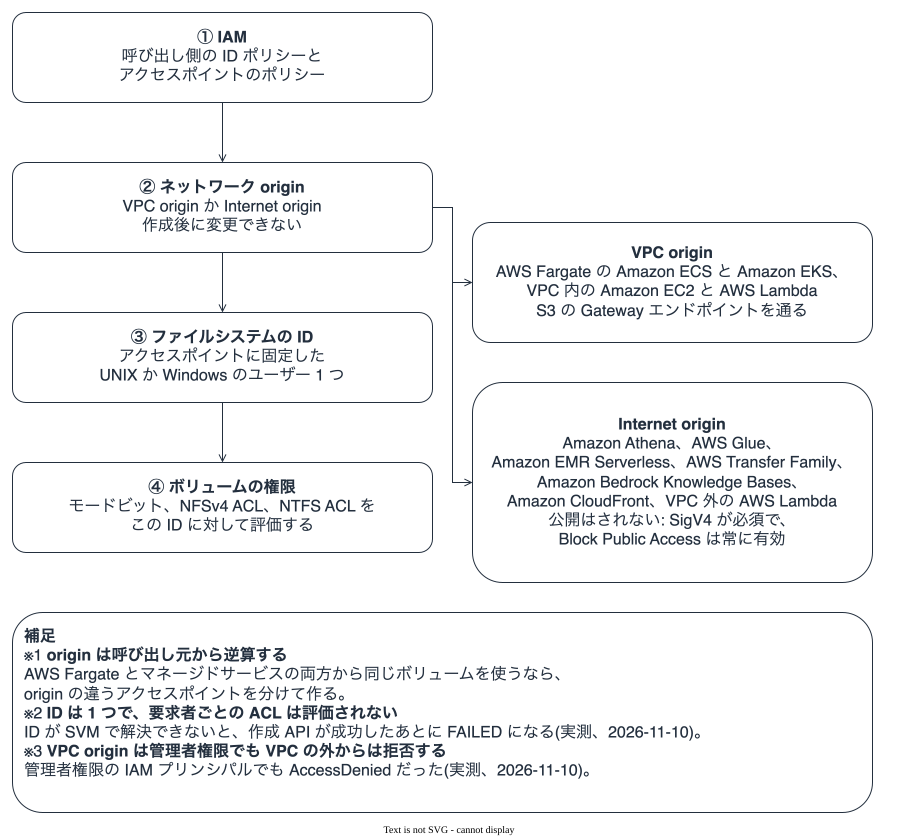
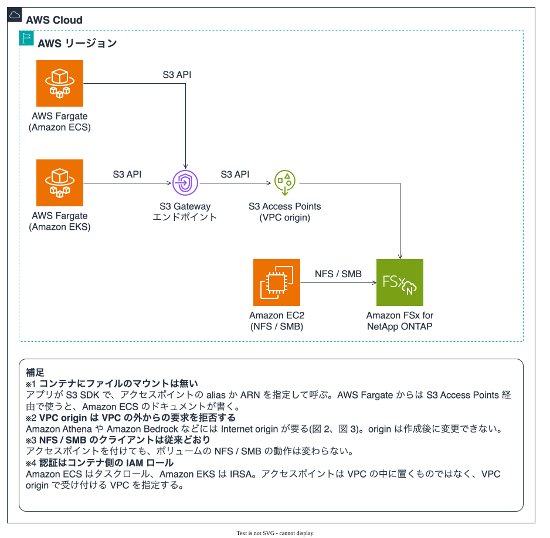
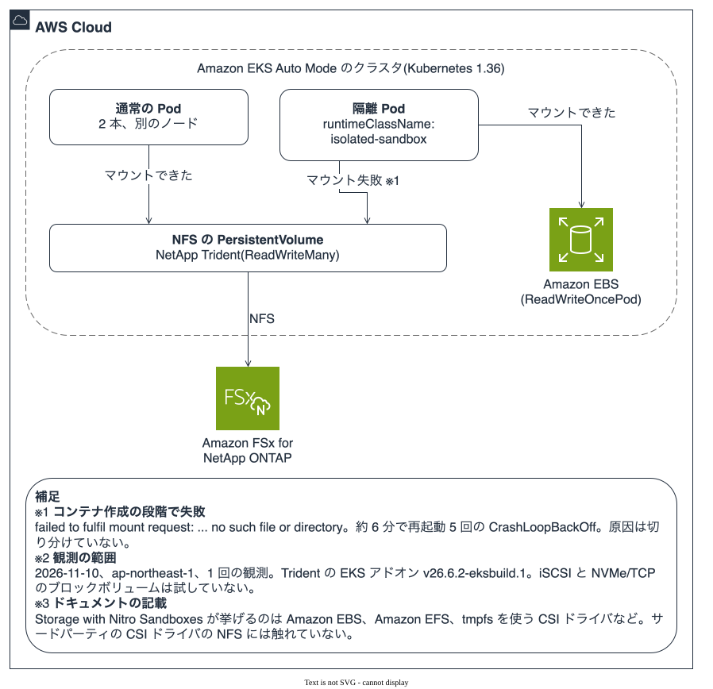

# S3 Access Points for FSx for ONTAP の利用シナリオと連携先の地図

🌐 **Language / 言語**: 日本語 | [English](../en/s3-access-points-usecase-map.md)

NFS / SMB で使っているデータを、コピーせずに S3 API でも読み書きする機能の、用途と連携先をまとめた文書である。オンプレミスの ONTAP での使われ方、Amazon FSx for NetApp ONTAP(以下 FSx for ONTAP)の新規ユーザーと既存ユーザーの用途、AWS のサービスと SaaS との連携、検討時に確認する前提を、根拠の種類を付けて並べる。実測は [storage-verification](atx-containerization-fsxn-storage-verification.md) の 5.4 にある。調査日は 2026-11-11 で、リージョン、バージョン、上限、価格は変わるので、使う前に出典を読み直す。

---

## 1. 結論

**この機能の分かれ目は、呼び出し元がどこにいるかで決まる origin(ネットワークの入口)である。** Fargate の ECS / EKS や VPC 内の EC2 は VPC origin、Amazon Athena や Amazon Bedrock などのマネージドサービスは Internet origin が要る。origin は作成後に変更できないので、使い始める前に呼び出し元から逆算して決める(図 2、8 章)。

AI エージェントや初見の読者は、次の 6 点を先に確認するとよい。

- アクセスポイントは、ボリュームに付ける S3 API の入口である。NFS / SMB の動作は変わらない [文書]。
- S3 の要求はすべて、アクセスポイントに固定した 1 つの UNIX か Windows のユーザーとして認可される。要求者ごとのファイル ACL は評価されない [文書]。
- そのユーザーが SVM で解決できないと、作成 API は成功を返したあとで FAILED になる [実測: 本リポジトリ、2026-11-10、1 回の観測]。
- ONTAP 9.17.1 以上、同一アカウント、同一リージョン、マウント済みのボリュームが前提になる [文書]。
- S3 のイベント通知、バージョニング、Object Lock、ライフサイクルは使えない [文書]。S3 の読み書きは、NFS / SMB とファイルシステムのスループットを分け合う [文書]。
- 連携先の確認状況は 7 章の表にある。公開された言及を見つけられなかったものは、「非対応」ではなく「公開された言及なし」と書いた。

| 知りたいこと | 読む章 |
|---|---|
| 全体像と、コンテナでの実機確認 | 9 章、図 1 |
| どのサービスから使えるか | 7 章、図 3 |
| origin と認可の決め方 | 8 章、図 2 |
| オンプレミスの ONTAP との違い | 4 章 |
| 新規ユーザー向け、既存ユーザー向けの用途 | 5 章、6 章 |
| アタッチ前の確認項目 | 6.2 |
| 制約の一覧 | 10 章 |

---

## 2. この文書で使う言葉

| 言葉 | 意味 |
|---|---|
| アクセスポイント | S3 Access Points。FSx for ONTAP のボリュームに付ける S3 API の入口。名前を持ち、IAM のポリシーを付けられる |
| alias | アクセスポイントを `--bucket` に渡すための名前(`-ext-s3alias` で終わる)。ARN でも指定でき、サービスによってどちらかしか受け付けない |
| origin | アクセスポイントを呼べるネットワークの範囲。VPC origin は指定した VPC から、Internet origin は VPC の外からも受け付ける。どちらも SigV4 が要る |
| ファイルシステムの ID | アクセスポイントに固定した UNIX か Windows のユーザー。すべての S3 要求は、このユーザーの権限でファイルを操作する |
| NAS バケット | オンプレミスの ONTAP S3 で、NAS ボリュームのディレクトリをバケットとして見せる仕組み(ONTAP 9.12.1 以降) |
| Hub / 他の Spoke | Hub は FSx for ONTAP の判断の指針を置く [FSx-for-ONTAP-Adoption-Playbook](https://github.com/Yoshiki0705/FSx-for-ONTAP-Adoption-Playbook)。他の Spoke は、同じ作者が実機の検証を置く別のリポジトリ(サーバーレス、データレイク、S3 Burst など)。リンク先に環境と日付がある |

---

## 3. エビデンス区分

| タグ | 意味 |
|---|---|
| **[文書]** | AWS / NetApp / 各サービスのユーザーガイドやリファレンスの記載。出典 URL を併記 |
| **[公表]** | AWS または NetApp が出した発表、ブログ、事例。販売や広報の文脈で、効果の数字は転記しない |
| **[実測: 本リポジトリ]** | このリポジトリで実機で確認した結果(5.4 に環境と範囲) |
| **[実測: 他の Spoke]** | 同じ作者の別リポジトリでの実機の結果。リンク先に環境と日付がある |
| **[公開された言及なし]** | 調べた範囲で見つからなかった。「非対応」を意味しない |
| **[仮説]** | 公開情報からの推測。確かめていない |
| **[未測定]** | 実行していない。本リポジトリと他の Spoke のどちらにも結果が無い |

---

## 4. オンプレミスの ONTAP での使われ方と、AWS 側への対応

この機能の原型は、オンプレミスの ONTAP にある。用途を先に見て、AWS 側との違いを 4.2 で並べる。

### 4.1 オンプレミスの用途

オンプレミスの ONTAP には、NAS ボリュームを S3 のバケットとして見せる「NAS バケット」がある(ONTAP 9.12.1 以降)。NetApp のドキュメントが挙げる用途は、NAS のクライアントが作ったデータを分析・BI・ML ツールが S3 で読むことと、同じデータを NAS と S3 の両方から読み書きするアプリである [文書]([NAS バケットの概要](https://docs.netapp.com/us-en/ontap/s3-multiprotocol/index.html)、[S3 の用途](https://docs.netapp.com/us-en/ontap/s3-config/use-cases.html))。

| 用途 | 根拠 |
|---|---|
| 分析・BI・ML・OCR のツールが、NAS のクライアントが書いたデータを S3 で読む | [文書]([NetApp](https://docs.netapp.com/us-en/ontap/s3-config/use-cases.html)) |
| Spark や Kafka 系のアプリが、同じファイルを NAS と S3 の両方で読み書きする | [文書]([NetApp](https://docs.netapp.com/us-en/ontap/s3-multiprotocol/index.html)) |
| データレイクの取り込み用の複製を作らず、NAS ボリュームを S3 として読む | [公表]([NetApp ブログ](https://www.netapp.com/blog/data-landing-zones-ontap-s3-nas-volumes/)、2025-05。効果として書かれた数字は測定が示されていない) |
| 学習用データを NAS で整え、ONTAP の S3 エンドポイントへ移して学習に使う | [公表]([NetApp の参照パイプライン](https://docs.netapp.com/us-en/netapp-solutions-ai/infra/ai-pipeline-solution-overview.html)。設計例で、利用者の事例ではない) |
| 遠隔拠点で、FlexCache のキャッシュボリュームを S3 で読む(9.18.1 以降、両クラスタ) | [文書]([FlexCache の FAQ](https://docs.netapp.com/us-en/ontap/flexcache/flexcache-duality-faq.html)) |
| NAS バケットのボリュームを、非同期のボリューム SnapMirror で保護する | [文書]([NetApp](https://docs.netapp.com/us-en/ontap/s3-multiprotocol/index.html)) |
| オンプレミスの ONTAP から FSx for ONTAP へ SnapMirror で複製し、アクセスポイントで AWS の AI・分析サービスに渡す | [公表]([NetApp ブログ](https://www.netapp.com/blog/data-access-s3-access-points-fsx-ontap/)、[発表](https://www.netapp.com/newsroom/press-releases/news-rel-20251202-161273/)、2025-12-02) |

**公開された実名の事例は見つからなかった。** NAS バケットを本番で使っている組織が名前つきで出ている公開ページ、第三者の検証記事、NAS バケットのスループットや遅延の数値は、調べた範囲で見つからなかった。

### 4.2 AWS 側のアクセスポイントとの違い

| 観点 | オンプレミスの NAS バケット | FSx for ONTAP のアクセスポイント |
|---|---|---|
| 入口 | SVM 上の S3 サーバー。LIF、FQDN、証明書を自分で用意 | AWS が管理する S3 エンドポイント。alias で呼ぶ |
| 認可の単位 | ONTAP の S3 ユーザーを NAS ユーザーに対応づける。S3 ユーザーごとに NAS の権限で判定 | IAM + アクセスポイントのポリシー。ファイル側は固定の 1 つの ID |
| ポリシー | ONTAP のバケットポリシー(使えるアクションは限定的) | IAM とアクセスポイントのポリシー |
| 未対応の機能 | バージョニング、Object Lock、ライフサイクル | 同じ。加えて ACL(`bucket-owner-full-control` 以外)、条件付き書き込み |
| チェックサム | 9.20.1 以降で保存して返す | アップロード時に検証するが、保存せず返さない |
| 保護 | 非同期のボリューム SnapMirror。同期と SVM-DR は対象外 | FSx の機能(バックアップ、SnapMirror)。途中のマルチパートは対象外 |

**要求者ごとの権限判定は、AWS 側には引き継がれない。** オンプレミスで S3 ユーザーごとに NAS の権限を適用していた設計は、アクセスポイントを要求者や権限の単位で分けて作り直す。AWS 側の仕組みが NAS バケットと同じ実装の上にあるかは、AWS と NetApp のどちらの文書にも書かれていない。この文書では「同じ未対応の機能が並ぶ」ことを事実とし、実装の関係は仮説に留める [仮説]。

---

## 5. FSx for ONTAP の新規ユーザーの用途

新規ユーザーは、ファイルシステムをこれから作る人と、移行の受け皿として作る人である。AWS の発表は、新しいファイルシステムから先に対応すると書いた [公表]([What's New、2025-12-02](https://aws.amazon.com/about-aws/whats-new/2025/12/amazon-fsx-netapp-ontap-s3-access/))。**新規と既存を分けて書いた公式の手引きは見つからなかった。この区分は、公開情報を並べ替えた整理である。**

| 用途 | 起点 | S3 アクセスが担うこと | 先に決めること | 根拠 |
|---|---|---|---|---|
| 移行した文書の共有フォルダを RAG や BI の対話に使う | PDF や Office ファイルが多い NAS | Amazon Bedrock Knowledge Bases や Amazon Quick が alias でボリュームを読む | Internet origin、ID の種別をボリュームのセキュリティスタイルに合わせる、ベクトルストア | [文書]([Bedrock のチュートリアル](https://docs.aws.amazon.com/fsx/latest/ONTAPGuide/tutorial-build-rag-with-bedrock.html))、[公表]([AWS News Blog](https://aws.amazon.com/blogs/aws/amazon-fsx-for-netapp-ontap-now-integrates-with-amazon-s3-for-seamless-data-access/)) |
| 既存システムが書くファイルを、SQL と ETL で扱う | CSV や Parquet を共有に出力する旧システム | Amazon Athena、AWS Glue、Amazon EMR Serverless が読む | Internet origin、Glue のデータカタログ | [文書]([Athena のチュートリアル](https://docs.aws.amazon.com/fsx/latest/ONTAPGuide/tutorial-query-data-with-athena.html)) |
| ファイルの自動処理(サムネイル、文字抽出、文字起こし) | 共有に置かれるコンテンツ | AWS Lambda が読み書きする | Lambda を VPC の外に置くか、VPC origin で VPC に入れるか | [文書]([Lambda のチュートリアル](https://docs.aws.amazon.com/fsx/latest/ONTAPGuide/tutorial-process-files-with-lambda.html)) |
| 外部の相手向けの SFTP / FTPS / FTP | 社内は SMB / NFS、相手は SFTP | AWS Transfer Family が alias でボリュームを読み書きする | Internet origin、alias のみ、ホームディレクトリは S3 API で作る | [文書]([Transfer Family](https://docs.aws.amazon.com/transfer/latest/userguide/fsx-s3-access-points.html))、[公表]([AWS Storage Blog](https://aws.amazon.com/blogs/storage/secure-sftp-file-sharing-with-aws-transfer-family-amazon-fsx-for-netapp-ontap-and-s3-access-points/)、2026-03) |
| 移行先のファイルシステムを、あとから S3 の利用者を足す前提で作る | オンプレミスの NAS からの移行 | 同じファイルシステムが、移行したアプリに NFS / SMB を、新しい利用者に S3 API を出す | ボリュームごとのセキュリティスタイル、AD 参加、スループットを NAS と S3 の合計で見積もる、ボリューム数の余裕 | [公表]([What's New](https://aws.amazon.com/about-aws/whats-new/2025/12/amazon-fsx-netapp-ontap-s3-access/))、[文書]([AWS](https://docs.aws.amazon.com/fsx/latest/ONTAPGuide/s3-ap-manage-access-fsxn.html)) |
| コンテナが共有の参照データを読む | ECS / EKS(EC2 と Fargate) | S3 SDK で alias を呼ぶ。マウントが無い | タスクロールか IRSA、VPC origin と Gateway エンドポイント | [文書]([ECS のストレージ](https://docs.aws.amazon.com/AmazonECS/latest/developerguide/using_data_volumes.html)、ECS のみ)、[公表](AWS News Blog)、[実測: 本リポジトリ](storage-verification の 5.4) |

**新規ユーザーが最初に決める 3 つ。** (1) ボリュームのセキュリティスタイルと ID の種別(UNIX と Windows)、(2) 呼び出し元ごとの origin、(3) ボリューム数。アクセスポイントを使うと、1 ファイルシステムあたりの最大ボリューム数が下がる。第 1 世代と、第 2 世代の HA ペア 1 組は 500 から 491、第 2 世代の HA ペア 2 組は 1,000 から 975、12 組では 903 になる [文書]([クォータ](https://docs.aws.amazon.com/fsx/latest/ONTAPGuide/limits.html)、2026-11-11 に確認)。

---

## 6. FSx for ONTAP の既存ユーザーの用途と、アタッチ前の確認

動いているファイルシステムに付ける場合の用途を 6.1 に、付ける前に確認する項目を 6.2 に置く。

### 6.1 用途

AWS のドキュメントは、アクセスポイントを付けても、ボリュームの NFS / SMB の動作は変わらないと書く [文書]([アクセスの管理](https://docs.aws.amazon.com/fsx/latest/ONTAPGuide/s3-ap-manage-access-fsxn.html))。

| 用途 | 起点 | 根拠 |
|---|---|---|
| 動いている共有に AI・分析を足す(複製を作らない) | SMB / NFS で使われている部門の共有 | [文書]、[公表] |
| AD に参加した SVM で、利用者や部署ごとにアクセスポイントを分け、BI・AI ツールに渡す | NTFS の ACL で権限を管理している共有 | [公表]([AWS Storage Blog](https://aws.amazon.com/blogs/storage/enabling-ai-powered-analytics-on-enterprise-file-data-configuring-s3-access-points-for-amazon-fsx-for-netapp-ontap-with-active-directory/)、2026-04) |
| 既存の NFS / SMB のワークフローに、相手向けの SFTP を足す | すでにファイルを出し入れしているアプリ | [文書]、[公表](AWS Storage Blog、2026-03) |
| 定期同期のパイプライン(ナレッジベースの同期、クローラ、バッチの ETL) | 旧アプリが一定時刻に書くファイル | [文書]。S3 のイベント通知は使えないので、読み取り側が時刻で動く |
| Lambda やコンテナを、旧アプリのそばで動かす | 段階的なモダナイゼーション | [文書](Lambda)、[実測: 本リポジトリ](Fargate の ECS / EKS) |

SnapMirror の宛先ボリュームから分析する使い方について、AWS は「データ保護ボリュームにもジャンクションパスがあればアクセスポイントを付けられる」と書く [文書]。SnapMirror の切り替え後や復元後のアクセスポイントの挙動は、公開された記述を見つけられず、どのリポジトリでも試していない [未測定]。

### 6.2 アタッチ前の確認項目

| # | 確認すること | 根拠 |
|---|---|---|
| 1 | ONTAP が 9.17.1 以上か(ONTAP の REST API の `GET /api/cluster?fields=version` か CLI の `version` で読める)。既存のファイルシステムが 9.17.1 になる方法は、2025-12-02 の発表にある「次回のメンテナンスウィンドウ」の 1 文しか見つからなかった | [文書]([制約](https://docs.aws.amazon.com/fsx/latest/ONTAPGuide/access-point-for-fsxn-restrictions-limitations-naming-rules.html))、[公表] |
| 2 | ボリュームがマウントされているか(ジャンクションパス)。オフラインやアンマウントになると MISCONFIGURED になる | [文書] |
| 3 | SVM で S3 プロトコルが許可されているか | [文書] |
| 4 | 指定する ID が ONTAP で解決できるか。UNIX はネームサービスの設定(ローカル、LDAP)、Windows は参加した AD で確かめる。解決できなければ FAILED か MISCONFIGURED になる | [文書]、[実測: 本リポジトリ](`ec2-user` で FAILED。本リポジトリで試した ID は UNIX のみ) |
| 4a | SVM が AD に参加している場合、AD のドメインコントローラに到達できるか。到達できないと、ListObjectsV2、GetObject、PutObject が AccessDenied になる一方、HeadBucket は成功するので、HeadBucket は健全性の確認に使えない | [実測: 他の Spoke]([AD 参加 SVM の前提](https://github.com/Yoshiki0705/FSx-for-ONTAP-S3AccessPoints-Serverless-Patterns/blob/main/docs/en/ad-joined-svm-s3ap-prerequisites.md)) |
| 5 | ID の種別がボリュームのセキュリティスタイルに合っているか(UNIX スタイルに UNIX、NTFS に Windows) | [文書] |
| 6 | 既存の共有・エクスポートの制御の扱い。SMB の共有権限は S3 経路に適用されず、ファイル / フォルダの NTFS ACL だけが適用されると AWS のブログは書く(本リポジトリでは Windows の ID を試していない)。NFS のエクスポートポリシーとの関係は、公開された記述を見つけられなかった | [公表] |
| 7 | スループットの余裕。S3 の要求はファイルシステムのスループットを使い、超えると `503 Slow Down` などで返る | [文書]([トラブルシューティング](https://docs.aws.amazon.com/fsx/latest/ONTAPGuide/troubleshooting-access-points-for-fsxn.html)) |
| 8 | ボリューム数が上限に収まるか。第 1 世代と第 2 世代の HA ペア 1 組で 491、HA ペア 2 組で 975、12 組で 903 | [文書](クォータ) |
| 9 | 呼び出し元ごとの origin。origin は作成後に変更できない | [文書]([ネットワーク](https://docs.aws.amazon.com/fsx/latest/ONTAPGuide/configuring-network-access-for-s3-access-points.html)) |
| 10 | 同一アカウント・同一リージョンか | [文書] |
| 11 | S3 のイベント通知、バージョニング、Object Lock、ライフサイクルを前提にした設計になっていないか | [文書]([互換性](https://docs.aws.amazon.com/fsx/latest/ONTAPGuide/access-points-for-fsxn-object-api-support.html)) |
| 12 | NFS / SMB で作ったディレクトリは、空になると S3 側から消える。S3 側が依存するディレクトリは、S3 API で作る | [公表](AWS Storage Blog) |

### 6.3 状態と最初の対処

| 状態 | 主な原因 | 最初の対処 | 根拠 |
|---|---|---|---|
| FAILED(作成直後) | ID を SVM が解決できない | アクセスポイントを削除し、解決できる ID で作り直す。ID は作成後に変更できない | [実測: 本リポジトリ](約 45 秒後に FAILED) |
| MISCONFIGURED | ID が解決できなくなった、ボリュームがオフラインかアンマウント | ネームサービスかボリュームを直す。原因が解消すると AVAILABLE に戻る | [文書]([作成手順](https://docs.aws.amazon.com/fsx/latest/ONTAPGuide/create-access-points.html)) |
| AccessDenied(VPC の外から) | VPC origin のアクセスポイント | 呼び出し元に合う origin のアクセスポイントを別に作る | [実測: 本リポジトリ] |
| AccessDenied(AD 参加 SVM) | ドメインコントローラに到達できない | DC への経路と DNS を確かめる | [実測: 他の Spoke] |
| `503 Slow Down` など | スループットの不足 | CloudWatch のスループット使用率を見て、スループット容量を上げる | [文書]([トラブルシューティング](https://docs.aws.amazon.com/fsx/latest/ONTAPGuide/troubleshooting-access-points-for-fsxn.html)) |

監視には、Lifecycle の状態の定期取得と、小さいオブジェクトの書き込み・読み戻し(sha256 の比較)が使える。HeadBucket だけでは、AD 参加 SVM の異常を見落とす。

---

## 7. 連携先の地図

図 3: 連携先を origin で分けた地図。図に描いたのは、AWS の文書か実測で origin が分かっているサービスである。制約(Athena は読み取りのみ、EMR の Iceberg 書き込みは不可など)と、図に無いサービスは 7.1〜7.5 の表にある。

**表の読み方。** 「区分」は 3 章のタグ。1 つの行に複数のタグがあるときは、それぞれの根拠が別にある。

### 7.1 AWS のコンピュートとコンテナ

| 連携先 | origin | 使い方 | 区分 | 注意 |
|---|---|---|---|---|
| Amazon ECS(AWS Fargate) | VPC | S3 SDK で alias か ARN を呼ぶ。タスクロール | [文書]([ECS のストレージ](https://docs.aws.amazon.com/AmazonECS/latest/developerguide/using_data_volumes.html): FSx for ONTAP は EC2 でネイティブのマウント、Fargate は S3 Access Points 経由)、[実測: 本リポジトリ] | マウントは無い。Gateway エンドポイントは、オンプレミスやピアリング経由の通信を通さない |
| Amazon EKS(AWS Fargate) | VPC | IRSA。CoreDNS を Fargate に載せる | [実測: 本リポジトリ] | AWS の公開ページで EKS を名指ししたものは見つからなかった |
| Amazon EKS(EC2) | VPC | ノードか Pod の IAM で S3 SDK を呼ぶ | [公開された言及なし] | storage-verification の EKS on EC2 の実測は Trident の PV で、S3 経路とは別 |
| AWS Lambda | VPC 外は Internet、VPC 内は VPC | S3 SDK。ファイルの自動処理 | [文書]、[実測: 他の Spoke]([ネットワークの検証](https://github.com/Yoshiki0705/fsxn-lakehouse-integrations/blob/main/docs/en/fsx-ontap-s3ap-networking.md)) | VPC 内の Lambda から Internet origin を Gateway エンドポイント経由で呼ぶとタイムアウトした。NAT か VPC の外の Lambda は通った |
| Amazon EC2 | どちらも | AWS CLI や SDK | [文書] | NFS / SMB のマウントと併用できる |
| AWS Batch | 記載なし | 記載なし | [公開された言及なし] | コンテナのジョブなので、S3 SDK を使えば ECS と同じと推測する [仮説] |

### 7.2 AWS のデータ・分析・AI

| 連携先 | origin | 使い方 | 区分 | 注意 |
|---|---|---|---|---|
| Amazon Athena | Internet | Glue のカタログに alias の LOCATION | [文書]([チュートリアル](https://docs.aws.amazon.com/fsx/latest/ONTAPGuide/tutorial-query-data-with-athena.html))、[実測: 他の Spoke]([互換性表](https://github.com/Yoshiki0705/fsxn-lakehouse-integrations/blob/main/docs/en/compatibility-matrix.md)) | 読み取り専用。Parquet / CSV / JSON / ORC と、Iceberg の読み書きを確認(2026-08-06、小規模) |
| AWS Glue | Internet | クローラと ETL | [文書]、[実測: 他の Spoke](互換性表) | Parquet の追記は確認済み。上書きは削除 + 書き込みで原子的ではない |
| Amazon EMR Serverless | Internet | Spark で読み書き | [文書]、[実測: 他の Spoke](互換性表) | Parquet の読み取りと追記を確認。条件付き書き込みが無いので Iceberg の書き込みは非対応 |
| Amazon Redshift Spectrum | Internet(Athena の記載から) | 外部スキーマ | [実測: 他の Spoke](互換性表、2026-05-23) | AWS の文書は Athena のカタログを再利用できると書くだけ |
| Amazon Bedrock Knowledge Bases | Internet | データソースに alias | [文書]([チュートリアル](https://docs.aws.amazon.com/fsx/latest/ONTAPGuide/tutorial-build-rag-with-bedrock.html))、[実測: 他の Spoke](互換性表) | 50 MB を超えるファイルは取り込まれない。ACL は索引に引き継がれない |
| Amazon Quick | 記載なし | S3 の統合に alias を入れる | [公表](AWS Storage Blog、2026-04) | 取り込みに使う ID が読めないと同期が失敗する。[実測: 他の Spoke]は無い([Hub の整理](https://github.com/Yoshiki0705/FSx-for-ONTAP-Adoption-Playbook/blob/main/docs/ja/ai-agents/quick/README.md)) |
| Amazon Textract / Amazon Transcribe | Lambda 経由 | Lambda が読んで API に渡す。Transcribe は alias を直接渡せる | [文書](Lambda のチュートリアル) | Textract の同期 API は 10 MB・1 ページまで |
| Amazon SageMaker | 記載なし | 発表文に「学習に使える」と書かれている | [公表](文のレベルのみ) | 手順のページは見つからなかった |

### 7.3 転送・配信

| 連携先 | origin | 使い方 | 区分 | 注意 |
|---|---|---|---|---|
| AWS Transfer Family | Internet | alias のみ(ARN は不可)。SFTP / FTPS / FTP | [文書]([Transfer Family](https://docs.aws.amazon.com/transfer/latest/userguide/fsx-s3-access-points.html))、[公表] | リネームと追記は不可。ホームディレクトリは S3 API で作る |
| Amazon CloudFront | Internet | オリジンに指定。OAC で SigV4 | [文書]([チュートリアル](https://docs.aws.amazon.com/fsx/latest/ONTAPGuide/using-access-points-with-aws-services.html)) | CDN ごとの署名の扱いは自環境で確かめる |

### 7.4 SaaS と ISV

| 連携先 | 区分 | 注意 |
|---|---|---|
| Snowflake | [実測: 他の Spoke](互換性表、2026-08-06) | ステージに `AWS_ACCESS_POINT_ARN` を指定。付けないと `LIST` は通り `SELECT` は拒否された。Snowpipe の自動取り込みは通知が無いので使えない |
| Databricks | [実測: 他の Spoke](互換性表、2026-08-12) | Unity Catalog の外部ロケーションは登録できるが、読み取りは拒否された。ベンダーの公開記述は見つからなかった |
| Dremio | [公表]([Dremio のブログ](https://subsurface2.dremio.com/blog/from-file-systems-to-ai-insights-dremio-cloud-amazon-fsx-for-netapp-ontap/)、2026-09) | 限界や測定は書かれていない |
| Nextcloud | [実測: 他の Spoke]([検証用ハーネス](https://github.com/Yoshiki0705/FSx-for-ONTAP-S3AccessPoints-Serverless-Patterns/blob/main/solutions/nextcloud-test/README.md)) | ベンダーの公開ページは見つからなかった |
| Splunk、Elastic、バックアップ製品など | [公開された言及なし] | 調べた範囲では、アクセスポイントを読む側としての記述は無かった |

NetApp が「50 以上の AWS サービスと Snowflake や Databricks につながる」と書いた発表がある [公表]。Databricks の部分は、上の実測と食い違う。どちらが正しいかは決めず、両方を並べる。

### 7.5 公開された言及が見つからなかったもの

次は「非対応」ではなく、調べた範囲で公開された記述が無かったものである。AWS DataSync(S3 ロケーションのページがアクセスポイントに触れるのは S3 on Outposts のみ)、AWS Backup、Amazon Macie と Amazon GuardDuty Malware Protection for S3(どちらのドキュメントも汎用バケットを前提にしている)、AWS Storage Gateway、Amazon OpenSearch Service(Bedrock のベクトルストアとしてのみ)、Amazon Comprehend、Amazon Rekognition。

---

## 8. origin と認可の選び方

図 2: リクエストが通る 4 つの関門と、origin による呼び出し元の分かれ方。

**関門は 4 つで、すべてを通る必要がある。後ろの 2 つは AWS の IAM の外にある。** IAM とアクセスポイントのポリシー(1)、origin(2)、アクセスポイントに固定した ID(3)、ボリュームのモードビットや ACL(4)である。図の番号は読む順の目安で、AWS が評価の順序をこう定めたという記述ではない。評価の順序は Hub の[決定木](https://github.com/Yoshiki0705/FSx-for-ONTAP-Adoption-Playbook/blob/main/docs/ja/reference/decision-trees/access-point-authorization.md)が出典つきで扱う。同一アカウントでは、ID ポリシーかアクセスポイントのポリシーのどちらかが許可すれば成立するため、制限するには明示的な Deny を書く [文書]。

| 呼び出し元 | origin | `--bucket` に渡すもの | 認証 | 根拠 |
|---|---|---|---|---|
| Amazon ECS(AWS Fargate) | VPC | alias か ARN | タスクロール | [実測: 本リポジトリ] |
| Amazon EKS(AWS Fargate) | VPC | alias か ARN | IRSA(Fargate では EKS Pod Identity を使えない) | [実測: 本リポジトリ] |
| VPC 内の Amazon EC2 / AWS Lambda | VPC(S3 の Gateway エンドポイント) | alias か ARN | インスタンスロール / 実行ロール | [文書] |
| VPC 外の AWS Lambda | Internet | alias か ARN | 実行ロール | [文書]、[実測: 他の Spoke] |
| Amazon Athena / AWS Glue / Amazon EMR Serverless | Internet | Glue のカタログに alias | 各サービスのロール | [文書]、[実測: 他の Spoke] |
| Amazon Bedrock Knowledge Bases | Internet | データソースに alias | サービスロール(ポリシーはアクセスポイントの ARN) | [文書] |
| AWS Transfer Family | Internet | alias のみ | ユーザーごとの IAM ロール | [文書] |
| Snowflake | 他の Spoke の実測は Internet | ステージに alias と `AWS_ACCESS_POINT_ARN` | ストレージ統合の IAM ロール | [実測: 他の Spoke] |

- **ポリシーの `Resource` は、アクセスポイントの ARN にする。** `Resource: '*'` は S3 Control に拒否された [実測: 本リポジトリ、2026-11-10]。
- **VPC origin は VPC の外からの要求を拒否する。** 管理者権限の IAM プリンシパルでも AccessDenied だった [実測: 本リポジトリ、2026-11-10]。Internet origin も公開ではなく、SigV4 が要り、Block Public Access は常に有効である [文書]。
- **同じボリュームを Fargate とマネージドサービスの両方から使うなら、origin の違うアクセスポイントを分ける。** AWS のブログも、要件の違う相手ごとにアクセスポイントを分けることを勧めている [公表]。
- **ID は非 root の専用ユーザーにする。** SVM のローカルユーザーを使うと、モードビットで読み書きの範囲が絞られた [実測: 本リポジトリ、5.4]。`root` はすべてのファイルを認可するので、測定の条件に留める。
- **AD に参加した SVM では、DNS やドメインコントローラに到達できないと、UNIX スタイルのボリュームでもアクセスポイントの呼び出しが失敗した。** 6.2 の 4a と 6.3 に対処を置いた [実測: 他の Spoke]([ネットワークの検証](https://github.com/Yoshiki0705/fsxn-lakehouse-integrations/blob/main/docs/en/fsx-ontap-s3ap-networking.md))。

認可の評価順序の詳細は、Hub の[アクセスポイントの認可の層](https://github.com/Yoshiki0705/FSx-for-ONTAP-Adoption-Playbook/blob/main/docs/ja/domains/security-governance/notes/access-point-authorization-layers.md)にある。

---

## 9. コンテナでの実機確認と、隔離 Pod との組み合わせ

図 1: コンテナがボリュームに到達する経路。

2026-11-10 に ap-northeast-1 で、使い捨ての SVM とボリュームに対し、Fargate の ECS と EKS(1.35)から読み書きと一覧を確認した [実測: 本リポジトリ]。alias と ARN の両方で通り、書き込み前後の sha256 が一致した。NFS 側から見たときの可視性、`ec2-user` での FAILED、非 root ユーザーでの権限、撤収後の基線との一致を含む全結果は、[storage-verification の 5.4](atx-containerization-fsxn-storage-verification.md) にある。見つけた不具合 2 件(ポリシーの `Resource`、ID の既定値)は、テンプレートで直してある。

図 4: 隔離 Pod でマウントできたストレージと、できなかったストレージ

**EKS の隔離 Pod(Nitro Sandbox)では、Trident の NFS の PV が使えなかった。** コンテナ作成の段階で失敗し、EBS の PVC は使えた(1 回の観測)。FSx for ONTAP のデータを隔離 Pod で使う選択肢としては、アクセスポイント経由で S3 SDK から読む形もありうる。ただし隔離 Pod からアクセスポイントを呼ぶ構成は、確かめていない [未測定]。観測の詳細は [storage-verification の 9.1](atx-containerization-fsxn-storage-verification.md) にある。サードパーティ CSI の扱いの明記を[文書フィードバック](https://github.com/awsdocs/amazon-eks-user-guide/issues/1259)で、NFS とブロックの対応を機能要望([NFS](https://github.com/aws/containers-roadmap/issues/2911)、[ブロック](https://github.com/aws/containers-roadmap/issues/2912))で公開した。issue の提出は、AWS が受理や優先付けをしたことを意味しない。

---

## 10. 制約と前提の一覧

| 項目 | 内容 | 出典 |
|---|---|---|
| ONTAP | 9.17.1 以上 | [文書] |
| アカウントとリージョン | ボリュームと同一 | [文書] |
| ボリューム | マウント済み。SVM で S3 を許可 | [文書] |
| 使えない S3 機能 | ACL(`bucket-owner-full-control` 以外)、Object Annotations、Requester Pays、バージョニング、Object Lock、ライフサイクル、静的 Web ホスティング、MFA Delete、条件付き書き込み、バケット通知の取得 | [文書]([互換性](https://docs.aws.amazon.com/fsx/latest/ONTAPGuide/access-points-for-fsxn-object-api-support.html)) |
| ストレージクラス・暗号化 | `FSX_ONTAP` のみ、SSE-FSX のみ | [文書] |
| アップロードの最大サイズ | 1 回の PutObject と 1 パートは 5 GiB(5,368,709,120 バイト)、マルチパートでのオブジェクト全体は 50 GiB。全体の上限は CompleteMultipartUpload で初めて判定され、転送を終えてから拒否される。アップロード前にクライアント側でサイズを確かめる。測定は第 1 世代 Single-AZ、128 MBps、ID は `root`、Internet origin | [文書](50 GiB)、[実測: 他の Spoke]([オブジェクトサイズの検証](https://github.com/Yoshiki0705/FSx-for-ONTAP-S3AccessPoints-Serverless-Patterns/blob/main/docs/s3ap-object-size-limits-verification.en.md)、2026-08-02) |
| コピー | 同一アクセスポイント内のみ [文書]。UploadPartCopy は、文書上は対応だが `NoSuchKey` で失敗した | [文書]、[実測: 他の Spoke](同上) |
| チェックサム | 検証するが保存せず、返さない。ETag は MD5 ではない | [文書] |
| 途中のマルチパート | ボリュームのバックアップに含まれない。使った容量はファイルシステムの `StorageUsed` に出て、ボリュームには出ない | [文書] |
| スループット | ファイルシステムのプロビジョンド スループットに依存。遅延は「数十ミリ秒」[文書]。128 MBps の第 1 世代 Single-AZ、Internet origin で、1 MB の GetObject の P50 は VPC 外の Lambda から 73 ms、手元のクライアントから 175 ms(並列度 10)。並列度 25 以上で P99 が 1 秒を超えた。VPC origin の経路はこのベンチマークでは測っていない。サイジングの目安で、サービスの上限ではない | [文書]、[実測: 他の Spoke]([ベンチマーク](https://github.com/Yoshiki0705/FSx-for-ONTAP-S3AccessPoints-Serverless-Patterns/blob/main/docs/s3ap-benchmark-results.en.md)、2026-05) |
| 料金 | FSx の料金に加え、アクセスポイント経由の S3 リクエストとデータ転送が課金される。単価は[FSx for ONTAP の料金](https://aws.amazon.com/fsx/netapp-ontap/pricing/)と S3 の料金ページで、リージョンと日付を確かめる。VPC 内の Lambda から Internet origin を使うなら NAT の料金も加わる | [文書]、[公表] |
| ボリューム数の上限 | 第 1 世代と第 2 世代の HA ペア 1 組で 500 → 491、HA ペア 2 組で 1,000 → 975、12 組で 903 | [文書] |
| 変更できないもの | origin、ファイルシステムの ID | [文書]、[実測: 本リポジトリ](ID は作成後に変更できない) |
| イベント通知 | 使えない(2026-11-11 時点)。FPolicy も、アクセスポイント経由の書き込みを検知しなかった(9 回の呼び出しで 0 件、2026-08-26) | [文書]、[実測: 他の Spoke]([証跡](https://github.com/Yoshiki0705/FSx-for-ONTAP-S3AccessPoints-Serverless-Patterns/blob/main/docs/aws-feature-requests/native-s3ap-notifications-evidence.en.md)) |
| NFS と S3 の同時書き込み | AWS のページに記述が見つからなかった。作者の別リポジトリに[書き込み衝突の検証](https://github.com/Yoshiki0705/FSx-for-ONTAP-S3AccessPoints-Serverless-Patterns/blob/main/docs/en/nfs-s3ap-write-conflict.md)がある | [公開された言及なし]、[実測: 他の Spoke] |

---

## 11. 食い違いが解けていない記述

次の 3 点は、AWS 自身の記述どうし、または記述と実測が食い違っている。決めずに並べる。使う前に出典を読み直す。

- **Transfer Family のアップロードの上限。** AWS Storage Blog(SFTP の記事)は 1 ファイル 5 GB と書く。他の Spoke の実測では、5 GiB は 1 回の PutObject の上限で、オブジェクト全体はマルチパートで 50 GiB まで書けた。Transfer Family がマルチパートを使うかは確かめていないので、ブログの 5 GB が Transfer Family の経路で正しいかは決めていない。
- **リージョン。** FSx のドキュメント履歴の 2026-11-06 の行が「China Regions」に触れるが、同じ日に読んだリージョン表には無い。
- **イベント通知。** リファレンスは `GetBucketNotificationConfiguration` を非対応とし、AWS のブログは S3 イベントによるトリガに触れる文がある。ブログの構成例は EventBridge のスケジュールと Step Functions の定期実行であり、リファレンスを優先した。

---

## 12. 自環境での確認手順

1. 呼び出し元を書き出し、7 章で origin を決める。マネージドサービスと VPC 内のコンピュートが混在するなら、アクセスポイントを分ける。
2. ID を決める。ボリュームのセキュリティスタイルに合わせ、SVM で解決できるかを ONTAP 側で確かめる。`root` は避ける。
3. ONTAP のバージョン、S3 プロトコル、ボリュームのマウント、ボリューム数の余裕を 6.2 で確かめる。
4. 使い捨てのボリュームで、作成 → 書き込み → 読み戻しの sha256 比較 → 一覧 → 撤収までを 1 回通す。テンプレートは `templates/containers-ecs-fargate-fsxn-s3ap.yaml` と `templates/containers-eks-fargate-fsxn-s3ap.yaml` で、`FileSystemUnixUser` は必須である。手順と期待する結果は [storage-verification の 5.4](atx-containerization-fsxn-storage-verification.md) にある。
5. 本番の前に、NFS / SMB のクライアントがある場合は、S3 の書き込みが NFS からいつ見えるかを自環境で測る。本リポジトリの観測は、約 28 秒後と約 100 秒後のどちらでも見えた、までである。
6. S3 のイベント通知を前提にした設計は、定期ポーリングに置き換える。

この文書は技術的な検討の材料で、セキュリティやコンプライアンスの評価に代わるものではない。本リポジトリの実測は、使い捨ての環境と合成データで行った。

---

## 参考リンク

- [Accessing your data via Amazon S3 access points](https://docs.aws.amazon.com/fsx/latest/ONTAPGuide/accessing-data-via-s3-access-points.html)
- [Access point compatibility](https://docs.aws.amazon.com/fsx/latest/ONTAPGuide/access-points-for-fsxn-object-api-support.html)
- [Managing access point access](https://docs.aws.amazon.com/fsx/latest/ONTAPGuide/s3-ap-manage-access-fsxn.html)
- [Using access points with AWS services](https://docs.aws.amazon.com/fsx/latest/ONTAPGuide/using-access-points-with-aws-services.html)
- [Amazon FSx for NetApp ONTAP now supports Amazon S3 access(What's New、2025-12-02)](https://aws.amazon.com/about-aws/whats-new/2025/12/amazon-fsx-netapp-ontap-s3-access/)
- [Amazon S3 Access Points for Amazon FSx are now available in additional AWS Regions(What's New、2026-11)](https://aws.amazon.com/about-aws/whats-new/2026/11/s3-access-points-fsx-regions/)
- [NetApp: S3 NAS buckets(multiprotocol)](https://docs.netapp.com/us-en/ontap/s3-multiprotocol/index.html)
- [storage-verification(本リポジトリ)](atx-containerization-fsxn-storage-verification.md)
